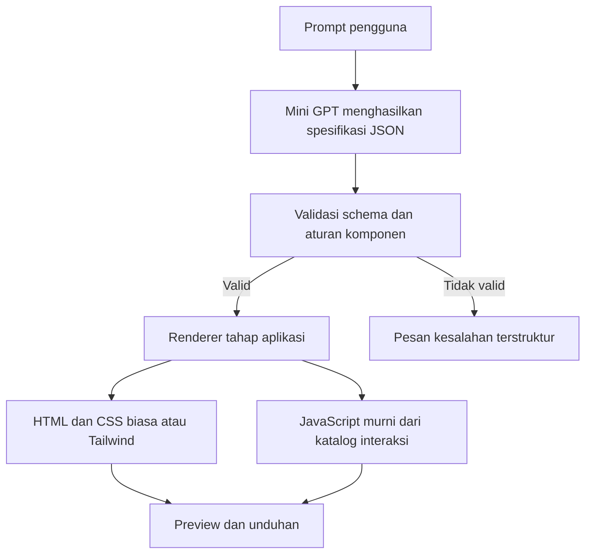
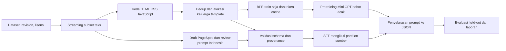

# Mini GPT WebCodeGen

Mini GPT WebCodeGen adalah proyek kuliah untuk membangun model generatif decoder-only dari bobot acak yang menghasilkan rancangan website. Model menulis spesifikasi halaman berbentuk JSON, aplikasi memvalidasinya, lalu renderer tahap akhir membuat HTML, CSS, dan JavaScript untuk preview serta unduhan.

## Ruang lingkup

### Masuk MVP

- Mini GPT dari bobot acak menggunakan PyTorch, causal self-attention, dan positional embedding mandiri.
- Pipeline dataset website, pasangan prompt-ke-rancangan, provenance lisensi, deduplikasi, split tanpa kebocoran, tokenizer, dan data loader.
- Pretraining autoregresif dari nol lalu penyelarasan instruksi prompt-ke-JSON pada model proyek yang sama.
- Spesifikasi halaman JSON yang tervalidasi, termasuk teks, urutan bagian, mode style, dan ID interaksi yang didukung.
- Tahap aplikasi akhir menghasilkan website statis HTML dengan CSS biasa atau Tailwind dan JavaScript murni, preview sandbox, serta unduhan.
- Log interaksi LLM, debugging, konfigurasi, metrik, evaluasi, dan keputusan kelompok.

### Di luar MVP

- Antarmuka aplikasi generator sebelum pipeline data, model, dan evaluasi siap.
- Backend, database, autentikasi, hosting, generator full-stack, atau kode JavaScript bebas.
- Bobot model bahasa pralatih, Bootstrap, React, Vue, atau screenshot-ke-kode.
- Mengunduh seluruh WebSight, sekitar 317 GB.

## Teknologi

| Bagian | Pilihan |
| --- | --- |
| Runtime | Windows 11, CPython 3.11.9 dalam `.venv` proyek |
| Model dan GPU | PyTorch 2.14.1+cu130, CUDA 13.0, RTX 5070 |
| Dataset | Python, Hugging Face Datasets streaming, JSONL, manifest JSON |
| Tokenizer | Byte-level BPE dilatih dari korpus proyek |
| Validasi target | JSON Schema dan pemeriksaan semantik terpilih |
| Keluaran aplikasi | HTML5, CSS biasa atau Tailwind, JavaScript murni |
| Metrik dan log | Markdown, JSONL/JSON, grafik loss |

Environment GPU tersedia dan sudah diperiksa secara lokal. Ukuran model dan konfigurasi training belum dipilih. Periksa ulang versi software sebelum membuat ulang environment.

## Alur produk



Model menghasilkan PageSpec dengan section terbatas seperti navbar, hero, feature grid, teks, pricing, dan contact form. Gaya satu halaman dipilih antara CSS biasa dan Tailwind. Interaksi JavaScript berasal dari katalog renderer seperti menu, accordion, tabs, modal, filter, dan validasi form. Model tidak mengeluarkan script bebas untuk langsung dieksekusi.

## Alur data dan training



## Dataset yang dipertimbangkan

- **WebSight v0.2**: kandidat data layout Tailwind. Gunakan subset teks streaming, bukan screenshot atau seluruh korpus. Sampel audit terdahulu terdiri dari 800 baris nonacak dan hanya satu memuat script. Kartu dataset menyatakan lisensi CC-BY-4.0 dan kewajiban atribusi/pengungkapan.
- **WebSight v0.1**: kandidat markup dan CSS biasa. Tidak ada kolom idea, jadi pasangan instruksi perlu dikurasi sebelum penyelarasan.
- **Vulcan**: seed kecil untuk CSS biasa dan JavaScript. Audit 5.000 baris menemukan 14 prompt unik dan dua isi script unik, jadi tidak cukup sebagai sumber tunggal.
- **Webdev Coding Dataset**: ditahan sampai data dan lisensi dapat diperiksa. Endpoint audit mengembalikan HTTP 401.
- **WebMC**: 600 soal pilihan ganda yang tersedia dipakai terpisah sebagai kandidat benchmark, bukan korpus utama generator.

Lihat [analisis dataset](docs/ANALISIS_DATASET_2026-10-12.md) dan [perbandingan stack](docs/PERBANDINGAN_DATASET_STACK_WEB_2026-10-12.md). Raw data, environment, checkpoint, dan output besar tidak dilacak Git. Ringkasan audit JSON yang kecil dicatat agar alasan seleksi bisa ditinjau.

## Persyaratan kelas

Panduan mensyaratkan kelompok beranggotakan empat, model generatif dari nol, penggunaan aktif LLM, larangan menyalin tutorial utuh, dan rekam jejak interaksi serta debugging. Mini GPT decoder-only tercantum sebagai pilihan. Rubrik memberi bobot 30% pada kualitas/orisinalitas Vibe Coding, 25% pada log interaksi, 25% pada model/training, serta 20% pada tim/integrasi. Nama anggota dan pembagian tugas perlu dilengkapi oleh kelompok.

Contoh Mini GPT di panduan memakai kutipan pendek. Proyek ini mengubah domain corpus menjadi halaman web, jadi kelompok perlu memastikan dosen menerima penyesuaian domain tersebut. Persetujuan dosen belum diperoleh atau diasumsikan.

Panduan menyebut training dan fine-tuning. Di proyek ini, model dimulai dari bobot acak. Penyelarasan prompt-ke-JSON melanjutkan training model proyek tersebut dan tidak memakai checkpoint pralatih eksternal.

## Status tahapan

1. Riset dataset dan environment GPU: selesai dan dicatat.
2. Scope, teknologi, alur pipeline, training log, dan rencana implementasi: disetujui pengguna.
3. Pipeline data: downloader, validator, normalizer, dedup/group split, BPE, dan batch loader sudah diimplementasikan. Download 55.000 teks selesai; hasil preparation dan pemeriksaan tersedia di manifest/laporan.
4. Mini GPT dan training: tahap berikutnya setelah pipeline data. SFT produksi menunggu review anotasi Indonesia.
5. Evaluasi held-out dan pengukuran model: menunggu training.
6. Aplikasi preview dan unduhan: tahap akhir.

Dokumen desain ada di [docs/README.md](docs/README.md), rencana implementasi di [rencana pipeline](docs/superpowers/plans/2026-10-12-pipeline-data-model-training.md), dan catatan eksperimen di [log training](logs/LOG_TRAINING.md).

## Environment lokal

Lihat [panduan environment](docs/PANDUAN_ENVIRONMENT.md).

```powershell
Set-Location 'F:\Generative_AI\Vibe_Coding_Proyek_1'
.\.venv\Scripts\Activate.ps1
```

Training Mini GPT, evaluasi model, dan aplikasi preview belum dijalankan.

## Menjalankan pipeline data

```powershell
.\.venv\Scripts\python.exe qa/run_logged.py --label download_dataset -- .\.venv\Scripts\python.exe -m src.data.sources --config configs/dataset.json
.\.venv\Scripts\python.exe qa/run_logged.py --label prepare_dataset -- .\.venv\Scripts\python.exe -m src.data.pipeline --config configs/dataset.json --train-tokenizer
.\.venv\Scripts\python.exe qa/run_logged.py --label data_integrity -- .\.venv\Scripts\python.exe qa/check_data_pipeline.py
```

Download memverifikasi dan memakai ulang file yang selesai. Config awal mematok 20.000 WebSight v0.1, 30.000 WebSight v0.2, dan 5.000 Vulcan; total raw 123.276.847 bytes. Cache dan data ada pada drive proyek. Batas raw 1 GiB dan reserve disk 15 GiB mencegah unduhan seluruh korpus.

CSS/JS standalone tetap menjadi teks untuk pretraining; target PageSpec hanya berasal dari anotasi reviewed. Grouping template adalah heuristik, sehingga pemeriksaan tanpa overlap group/exact hash tidak membuktikan nol kebocoran semantik.

Petunjuk rinci ada di [panduan pipeline](docs/PIPELINE_DATA_GUIDE.md) dan hasil nyata di [laporan status data](reports/STATUS_PIPELINE_2026-10-12.md). Manifest kecil menyimpan source revision/license/checksum, split, tokenizer, token profile, dan status instruksi. Vocabulary BPE 8.192 baru dilatih dari train split; blok pretraining 1.024 token memakai label next-token yang sudah digeser.

Review pipeline menemukan empat masalah yang telah diperbaiki dan dicatat di [laporan review](reports/REVIEW_PIPELINE_2026-10-12.md). Sebanyak 37 tests lulus. Family allocation dipakai bersama oleh pretraining dan SFT; preparation anotasi memverifikasi dan mempertahankan tokenizer/cache yang cocok. RUN-052 memeriksa ulang seluruh data aktual dan transfer batch ke RTX 5070. Model belum dilatih dan 119 draft produksi masih menunggu review.
