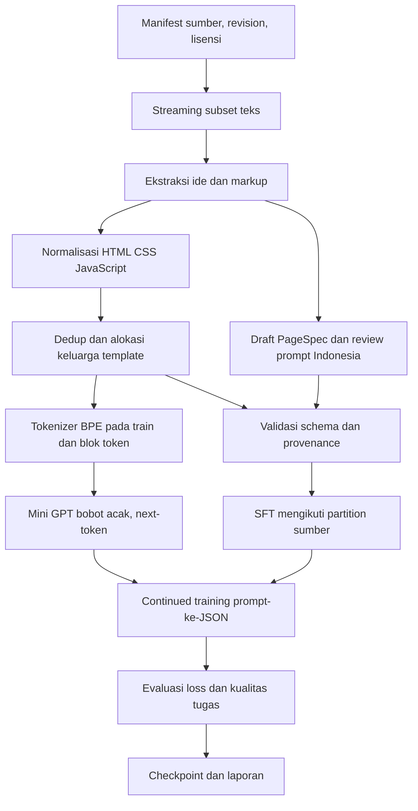
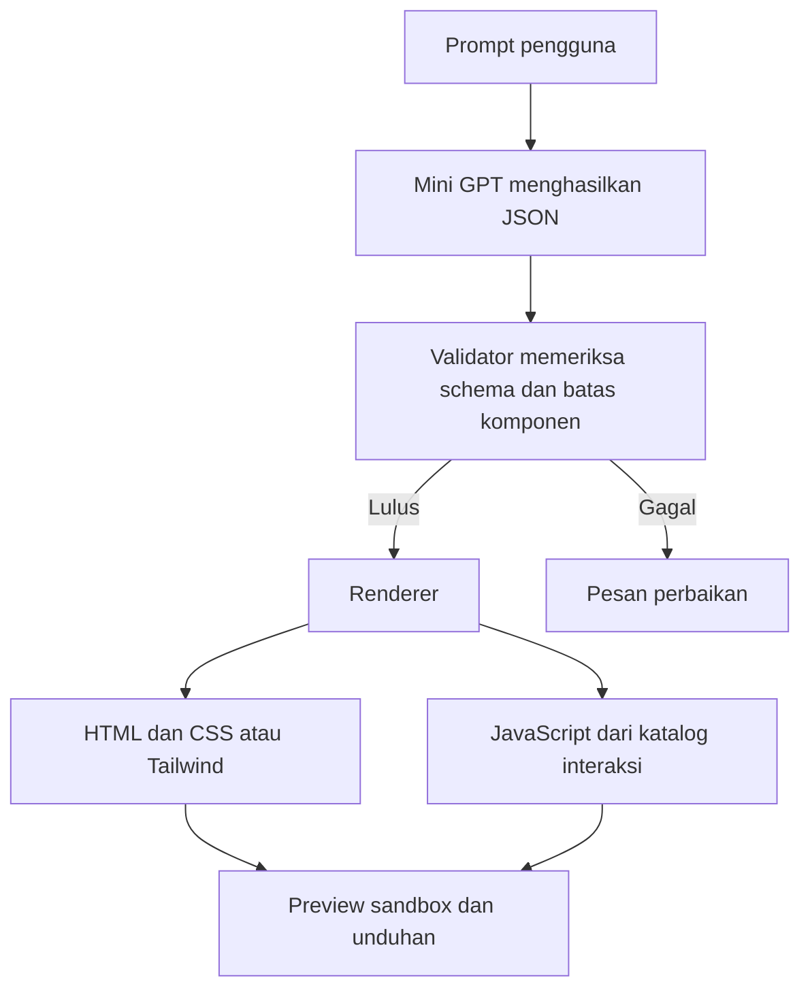

# Ruang Lingkup dan Rancangan Pipeline

Dokumen ini menetapkan desain Mini GPT WebCodeGen dan mencatat status implementasi pipeline data. Tujuan proyek adalah membuat model decoder-only dari bobot acak yang menghasilkan rancangan website terstruktur.

## Tujuan dan persyaratan tugas

Panduan kelas mensyaratkan kelompok empat orang, model generatif dari nol, Vibe Coding aktif, dokumentasi interaksi dan debugging, serta melarang salin-tempel tutorial utuh. Dokumentasi resmi pustaka boleh dijadikan rujukan. Mini GPT decoder-only dengan self-attention dan positional encoding mandiri tercantum sebagai pilihan. Rubrik: kualitas dan orisinalitas 30%, interaksi LLM 25%, model dan training 25%, kerja tim/integrasi 20%.

Ada satu penyesuaian yang perlu dikonfirmasi oleh kelompok kepada dosen: contoh Mini GPT pada panduan memakai corpus kutipan pendek, sedangkan proyek ini melatihnya pada teks dan struktur halaman website. Arsitektur tetap Mini GPT yang tercantum, tetapi domain corpus berubah. Jangan menyatakan adaptasi ini sudah disetujui dosen sebelum kelompok mendapat jawaban.

Mini GPT diinisialisasi secara acak. Tidak memakai checkpoint atau tokenizer pralatih. Training utama memakai prediksi token berikutnya pada teks/kode website; tahap penyelarasan meneruskan training model proyek pada prompt dengan target JSON. Dengan demikian penyelarasan bukan fine-tuning model bahasa eksternal.

## Ruang lingkup MVP

1. Prompt website berbahasa Indonesia menjadi target pengalaman awal. WebSight berbahasa Inggris, jadi prompt/teks yang diturunkan perlu diterjemahkan atau ditulis ulang dan ditinjau. Jangan klaim bilingual tanpa evaluasi.
2. Model menghasilkan JSON dengan judul, isi teks, urutan section/komponen, tema, mode style, dan ID interaksi yang diizinkan.
3. Validator memeriksa JSON Schema, field, panjang teks, jumlah section, style mode, dan interaksi.
4. Setiap halaman memakai salah satu mode: `plain_css` atau `tailwind`. MVP tidak mencampurkan bentuk styling tersebut dalam satu halaman.
5. Interaksi dibatasi ke katalog vanilla JavaScript renderer: menu responsif, accordion, tabs, modal, filter, dan validasi form.
6. Aplikasi tahap akhir menghasilkan `index.html`, `styles.css`, serta `app.js`, lalu menyediakan preview sandbox dan unduhan.
7. Setiap data, versi, konfigurasi, run, metrik, error, checkpoint, interaksi LLM, serta keputusan kelompok ditelusuri.

## Di luar MVP

Bootstrap, React/Vue, generator backend, database, autentikasi, hosting, screenshot-ke-kode, aplikasi full-stack, gambar yang digenerate, dan JavaScript bebas tidak masuk MVP. Aplikasi preview dan unduhan baru dibuat setelah pipeline data, model, dan evaluasi siap.

### PageSpec v1

Objek PageSpec memiliki field tetap `schema_version`, `title`, `language`, `style_mode`, `theme`, `sections`, dan `interactions`. Setiap section memiliki `id`, `type`, dan `props` yang divalidasi khusus untuk tipe komponennya. Daftar tipe section MVP adalah `navbar`, `hero`, `feature_grid`, `text_section`, `testimonial`, `pricing_table`, `contact_form`, dan `footer`.

`theme` memuat warna dan pilihan tipografi yang lolos schema. `interactions` berisi `target_id` serta `type` dari enum `menu_toggle`, `accordion`, `tabs`, `modal`, `filter`, dan `form_validate`. Tidak ada node `script` atau atribut event bebas. Renderer memetakan PageSpec yang sama menjadi CSS biasa atau Tailwind, lalu membuat JavaScript dari katalog interaksi.

## Teknologi yang direncanakan

| Lapisan | Pilihan |
| --- | --- |
| Sistem | Windows 11, CPython 3.11.9, VENV proyek |
| GPU dan tensor | PyTorch 2.14.1+cu130, runtime CUDA 13.0, RTX 5070 |
| Akuisisi | Hugging Face Datasets streaming, simpan source revision |
| Korpus | JSONL UTF-8 dengan manifest JSON lisensi dan transformasi |
| Schema | JSON Schema ditambah inspeksi semantik manual terpilih |
| Tokenizer | Byte-level BPE dilatih hanya dengan train split |
| Model | Decoder-only Transformer, random init, causal multi-head attention, positional embedding mandiri, MLP, residual, layer normalization |
| Loss/optimizer | Cross-entropy next-token dan AdamW; BF16 digunakan bila smoke profile stabil |
| Analisis | Metrik JSONL/CSV, grafik loss, checkpoint lokal |
| Produk tahap akhir | HTML5, CSS biasa atau Tailwind, vanilla JavaScript |

Versi PyTorch adalah versi VENV yang tersedia dan diuji secara lokal pada 12 Oktober 2026. Periksa ulang kompatibilitas sebelum instalasi ulang. Batch, learning rate, context length, scheduler, serta jumlah parameter dipilih setelah menghitung token dan mengukur penggunaan GPU.

## Dataset dan keputusan

| Dataset | Fungsi yang direncanakan | Batasan |
| --- | --- | --- |
| HuggingFaceM4/WebSight v0.1 | Kandidat markup/CSS biasa untuk next-token dan layout | 822.987 baris; tidak ada kolom idea; prompt perlu dikurasi untuk SFT; CC-BY-4.0 |
| HuggingFaceM4/WebSight v0.2 | Kandidat layout Tailwind melalui subset teks streaming | 1.922.671 baris; sekitar 286 GB parquet; idea tersedia; CC-BY-4.0; audit 800 baris nonacak menemukan satu script |
| xlelords/vulcan | Seed komponen untuk CSS biasa dan vanilla JS | MIT; audit 5.000 baris menemukan 14 prompt unik, dua isi script unik, dan prompt validation yang juga ada di train |
| Hoglet-33/webdev-coding-dataset | Ditahan sampai dapat diperiksa | Tiga endpoint memberi HTTP 401, jadi isi dan lisensi file belum diverifikasi |
| IFM/WebMC | Benchmark pilihan ganda terpisah | Repo aktual berisi 600 soal, bukan korpus training 50.000 pasangan yang disebut card |

Data tidak digabung sebelum schema dan license dicatat. Halaman sumber dikonversi ke PageSpec menggunakan anotasi terstruktur yang ditinjau kelompok; source code tidak diperlakukan sebagai PageSpec secara otomatis. `group_id` merepresentasikan keluarga halaman/template. Split dilakukan berdasarkan group, bukan baris, untuk mengurangi kebocoran. Dedup menyimpan alasan dan kunci pembanding. Test set ditahan hingga pilihan hyperparameter selesai.

Alokasi keluarga pretraining disimpan dan menjadi acuan SFT. Record instruksi membawa source_row_id dan source_group_id yang dihitung ulang dari raw code. Group manual yang menggabungkan partition berbeda ditolak; validation/test SFT tetap berada pada partition sumber yang sama, bukan diacak ulang pada subset anotasi.

## Diagram pipeline

Pretraining mempelajari struktur teks/kode dari sumber yang dikurasi. Pada tahap penyelarasan, prompt diikuti target PageSpec JSON dan loss dihitung pada token target, bukan prompt. Urutan field JSON kanonis ditetapkan agar target konsisten.

## Flow produk tahap akhir

Validator tidak menjamin kualitas isi. Renderer menerima hanya ID interaksi yang dikenal. Script mentah dari model tidak dieksekusi. Hasil preview diperlakukan sebagai konten tak tepercaya dan ditempatkan dalam sandbox.

## Kontrak modul

- `src/data/sources.py`: mengambil sumber yang diizinkan, revision, dan metadata lisensi.
- `src/data/normalize.py`: menghasilkan kode pretraining atau `PageExample` reviewed dengan prompt/target_spec, provenance, source_row_id/source_group_id, group_id, dan split. Style_mode/interactions dibaca dari target_spec.
- `src/data/validate.py`: memeriksa schema dan batas komponen/interaksi.
- `src/data/split.py`: alokasi group pretraining memakai seed konfigurasi; SFT mewarisi alokasi source family dan memeriksa konflik group manual.
- `src/data/integrity.py`: memverifikasi lineage tokenizer/cache dan SFT terhadap raw source serta alokasi keluarga bersama.
- `src/data/tokenizer.py`: melatih BPE pada train, menyimpan vocab dan hash.
- `src/data/dataset.py`: membuat token input dan label untuk pretraining/SFT.
- `src/models/minigpt.py`: menerima `[batch, sequence]`, menghasilkan logits `[batch, sequence, vocab]`.
- `src/training/train.py`: optimizer, validation, logging, checkpoint/resume dengan config, tokenizer, source manifest, dan RNG state.
- `src/evaluation/`: loss, perplexity, JSON parse/schema, prompt held-out, serta rubric kualitas halaman.

Kontrak data, model, training, dan evaluator telah diimplementasikan. PageExample adalah record kanonis, dengan alias WebPageExample; style_mode dan interactions dibaca dari target_spec. Validator berada pada schema.py dan diekspor kembali melalui validate.py. Mini GPT berparameter 14.186.496, loop BF16, checkpoint/resume, mask token, dan probe PageSpec tersedia. SFT belum dijalankan.

## Evaluasi dan gerbang tahap

### Data siap

- Streaming tidak mengunduh screenshot/binary dan membatasi penggunaan disk.
- Setiap contoh lulus parse, mencatat source revision/license, group, split, dan alasan filter.
- Duplication dan kebocoran keluarga template diperiksa; seed split mereproduksi hasil.
- Tokenizer dilatih hanya dari train split.
- Sampel data target JSON diperiksa secara semantik oleh kelompok.

### Model siap

- Bobot model berasal dari inisialisasi acak; implementasi causal attention dan positional embedding ditulis untuk proyek.
- Forward, loss, backward, AdamW, validation, save, dan resume diuji di VENV RTX 5070.
- Config dan state RNG tersimpan untuk setiap run. NaN, OOM, crash, dan stop tercatat.

### Evaluasi siap untuk aplikasi

- Test set tidak digunakan untuk hyperparameter.
- Laporan meliputi train/validation loss, perplexity yang definisinya jelas, JSON parse rate, schema pass rate, dan rubric semantik.
- Keluaran held-out disimpan. Rendering/interaksi hanya dinilai lulus setelah benar-benar dibuka dan diperiksa di browser.
- Keputusan ukuran model dibuat dari hasil nyata. GPU RTX 5070 tidak menjamin generalisasi model baru dari nol.

## Risiko

- Mengunduh seluruh WebSight akan melebihi ruang disk proyek, jadi gunakan streaming kolom teks.
- Korpus sintetis dapat mendorong pola berulang; kelompok template, dedup, dan held-out task diperlukan.
- Sumber Inggris tidak otomatis memberi kemampuan prompt Indonesia.
- JSON valid tidak selalu semantis benar, menarik, atau responsive.
- Tailwind hasil unduhan dapat memerlukan CDN kecuali CSS disediakan lokal. Packaging offline diputuskan di fase aplikasi.
- WebSight mewajibkan provenance dan pengungkapan penggunaan sesuai lisensinya.

## Status

Pembaruan AI-011: CLI menghasilkan dua research demo yang sesuai prompt, plain CSS dan Tailwind/JavaScript. [Hasil terbaru](../reports/OUTPUT_DEVELOPMENT_2026-10-13.md) membedakan output diterima per request dengan overall gate43/48yang gagal. UI generator bebas/browser acceptance belum tersedia. Tailwind dikompilasi lokal tanpa CDN. Paragraf berikut mencatat fase baseline sebelumnya.

Planning sudah disetujui pengguna. Download subset dan pipeline data telah dijalankan; BPE ditrain baru hanya pada train partition. Model dan pretraining baseline 1.200 update selesai, termasuk resume pada GPU dan evaluasi token test penuh. Loss test 1,071 / perplexity 2,918, tetapi 4 probe eksploratif menghasilkan 0 PageSpec JSON valid. SFT produksi menunggu anotasi Indonesia reviewed, dan aplikasi belum dibuat. Gerbang needs-data dijelaskan pada [laporan training](../reports/PIPELINE_TRAINING_SUMMARY.md). Urutan implementasi ada di [rencana implementasi](superpowers/plans/2026-10-12-pipeline-data-model-training.md), command data di [panduan pipeline](PIPELINE_DATA_GUIDE.md), dan training di [panduan training](TRAINING_GUIDE.md).
