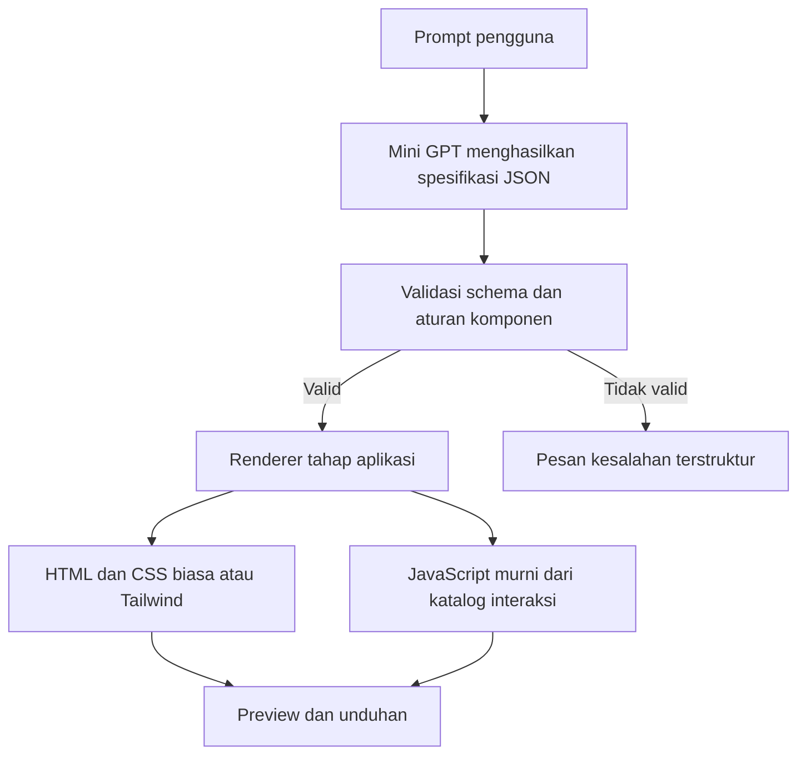
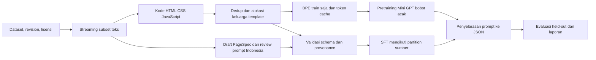

# Arsip sebelum penataan 1 November 2026

Snapshot historis dari README.md. Status terkini ada di [README utama](../../README.md). Tautan relatif disesuaikan dengan lokasi arsip.

# Mini GPT WebCodeGen

Mini GPT WebCodeGen adalah proyek kuliah untuk membangun model generatif decoder-only dari bobot acak yang menghasilkan rancangan website. Model menulis spesifikasi halaman berbentuk JSON, aplikasi memvalidasinya, lalu renderer tahap akhir membuat HTML, CSS, dan JavaScript untuk preview serta unduhan.

## Aplikasi chat generator, implementasi berjalan

Rancang memakai Next.js dan shadcn di `apps/web`, FastAPI di `apps/api`, serta pipeline source-bound yang sudah ada. Pengguna mengirim satu brief bebas. Endpoint ekstraksi hanya menerima fakta yang punya kutipan tepat di pesan pengguna, mengelompokkan kekurangan dalam satu klarifikasi, lalu membuka editor untuk bagian yang masih kurang setelah satu balasan belum lengkap. Pengguna memeriksa fakta dan bukti sumber sebelum memilih **Generate website**. Renderer lokal menyusun HTML, CSS, JavaScript, dan aset yang tervalidasi.

Model generator terpilih TRAIN-025 step 1.800 menerima `RequestDraft` yang sudah tervalidasi. Model tersebut belum dilatih untuk mengubah brief bebas menjadi fakta lengkap. Kandidat ekstraktor terpisah `REQUEST-EXTRACT-V1` step 1.800 sedang menjalani evaluasi development 15.200 scope dan belum dipromosikan. Ekstraksi otomatis tetap fail-closed sampai gerbang raw development dan safety API lulus. Jika ekstraktor tidak tersedia, UI mempertahankan brief dan menyediakan editor manual.

Build, lint, TypeScript, dan review browser responsif prompt-first lulus pada 17 Oktober 2026. Review memeriksa sesi kosong di ukuran sekitar 624 x 864 dan 1440 x 900. Jalur prompt-first belum diuji end-to-end dengan inference baru. Satu generation lokal `Kedai Demo` sebelumnya menghasilkan landing page Tailwind dengan 9 section memakai TRAIN-025 step 1.800, tetapi itu tidak membuktikan kualitas umum atau target visual 95 persen. Final/test tetap tertutup.

Panduan lokal ada di [apps/web/README.md](../../apps/web/README.md) dan [apps/api/README.md](../../apps/api/README.md). Kode training ada di `src/`; checkpoint, data dan output development tersimpan lokal dan diabaikan Git.

Kandidat runtime yang dipaketkan untuk generation adalah TRAIN-025 step 1.800. Panduan dan provenance ada di [paket runtime terpilih](../../training/selected/fullpage-v5/README.md). Salinan model dan output development hanya ada secara lokal dan diabaikan Git. Kode training tetap di `src/`, sedangkan checkpoint kanonis tetap di `checkpoints/`.

Kandidat generation lolos gerbang validator pada 80 dari 80 request development. Satu uji lokal pada 16 Oktober memakai usaha fiktif `Kedai Demo` dan menghasilkan landing page Tailwind dengan 9 section memakai TRAIN-025 step 1.800. Preview browser dan ZIP berhasil dibuka pada alur aplikasi sebelumnya. Bukti tersebut tidak menguji ekstraksi prompt-first, kualitas umum, atau target visual 95 persen. Data test dan final tetap tertutup. Rencana aplikasi ada di [roadmap generator](../superpowers/plans/2026-10-15-generator-app-roadmap.md) dan [desain aplikasi](../superpowers/specs/2026-10-15-generator-chat-application-design.md).

## Halaman utuh, AI-018

Generasi bertahap sudah diimplementasikan: request terstruktur → plan512 → isi section1536 → validasi fakta/komposer → HTML/CSS biasa atau Tailwind/JavaScript lokal. Context2048. TRAIN-016600 dan TRAIN-0172400 updates selesai di RTX5070 dengan batch16/accum3.

**Model belum mencapai gerbang95%.** Development best39/80 (48.75%), last58/80 (72.50%). Semua accepted menjadi halaman lengkap sembilan bagian, tetapi final baru tetap tertutup. Runtime historis v1 tidak diubah. UI, review manusia dan penerimaan browser masih pending.

Lihat [gallery last58 untuk diagnosis](../../examples/generated/AI-018-last-v2/index.html), [gallery best39](../../examples/generated/AI-018-best-v2/index.html), [notebook10](../../notebooks/10_fullpage_data_context_dan_gpu.ipynb), [notebook11](../../notebooks/11_fullpage_training_dan_generation.ipynb) dan [laporan lengkap](../../reports/FULL_PAGE_PROGRESS_2026-10-13.md). Data baru sintetis empat sektor; ini belum membuktikan semua prompt/layout bebas.

## Pengembangan terbaru, 13 Oktober 2026

**TRAIN-015 memenuhi gerbang kontrak terkontrol:** development 24/24 sesuai persis, final 48/48 JSON valid dan 44/48 sesuai persis (91,67%). Kandidat dipilih sebelum satu evaluasi final. Empat kesalahan tetap disimpan. Benchmark ini memakai recipe sintetis bersama dengan nama yang dipisahkan antar partition, sehingga belum membuktikan kemampuan prompt bebas atau layout baru.

Data v6 menambah 21.090 contoh train, total 40.158. Training 2.400 update selesai dalam 481 detik, dengan 46,35 juta label target dan sekitar 101.569 token target/detik saat update. GPU rata-rata 92,03%, maksimum 100%, suhu maksimum 68°C pada sampel update. Data, LR dan budget berbeda dari TRAIN-014; hasil ini bukan ablation yang mengisolasi efek data.

Runtime yang digunakan pada command terbaru adalah **TRAIN-015 best**. [Gallery 44 website](../../examples/generated/AI-013/index.html) dan [ZIP output](../../examples/generated/AI-013/websites.zip) berisi HTML, CSS biasa atau Tailwind lokal, JavaScript, prompt dan keluaran model. [Kafe Senandika](../../examples/generated/AI-013-senandika/index.html) yang sebelumnya salah kini diterima pada prompt development yang sama. **UI generator dan pemeriksaan browser belum selesai.**

Proses aktual tersedia di [notebook 08](../../notebooks/08_kualitas_penyalinan_dan_training.ipynb), [notebook 09](../../notebooks/09_evaluasi_final_dan_output.ipynb), [laporan final](../../reports/FINAL_GATE_2026-10-13.md), dan [log training](../../logs/LOG_TRAINING.md). Catatan berikut merupakan riwayat AI-011/AI-012 sebelum TRAIN-015.

Optimasi RTX 5070 sudah dijalankan: **batch 48, BF16, SDPA, fused AdamW**, proyeksi hanya token target, dan allocator expandable segments. TRAIN-014 selesai 800 update dalam 162 detik, sekitar 99.200 token target/detik atau 3,43 kali baseline probe. Utilisasi rata-rata 93,23%, maksimum 100%, dan suhu maksimum 67°C pada sampel update. Kualitas terpilih belum meningkat, best step 0 identik dengan parent; runtime tetap TRAIN-012. Lihat [laporan GPU](../../reports/GPU_TRAINING_OPTIMIZATION_2026-10-13.md) dan [notebook 07](../../notebooks/07_optimasi_gpu_dan_training.ipynb).

CLI prompt -> Mini GPT -> validasi PageSpec/kontrak -> renderer HTML/CSS/JavaScript sudah menghasilkan dua contoh Studio Cakrawala yang sesuai prompt, CSS biasa dan Tailwind dengan tabs. [Buka contoh hasil](../../examples/generated/AI-011/index.html) atau [unduh file](../../examples/generated/AI-011/examples.zip). Raw output/model SHA disertakan; tidak memperbaiki JSON atau mengganti nama setelah decoding.

Model runtime TRAIN-012 masih gagal overall quality gate:48/48schema valid,43/48exact89,58%, target90%. Contoh memakai **mode development** dengan validasi penuh per output, bukan klaim siap produksi. Kafe Senandika salah menjadi Senanka dan ditolak. Eksperimen name-weighted TRAIN-013 tidak meningkatkan validation; beststep0 identik parent. Final v5 belum dibuka. Prompt bebas/browser quality belum terbukti.

Lihat [hasil pengembangan](../../reports/OUTPUT_DEVELOPMENT_2026-10-13.md), [panduan generasi](../GENERATING_WEBSITES.md), dan [diagnosis/data curriculum](../SFT_DEVELOPMENT_2026-10-13.md). Dataset sintetis dipisahkan dari12 anotasi human-reviewed; model tetap berasal dari bobot acak proyek. Bagian baseline/pilot di bawah mencatat tahap sebelumnya.

## Ruang lingkup

### Masuk MVP

- Mini GPT dari bobot acak menggunakan PyTorch, causal self-attention, dan positional embedding mandiri.
- Pipeline dataset website, pasangan prompt-ke-rancangan, provenance lisensi, deduplikasi, split tanpa kebocoran, tokenizer, dan data loader.
- Pretraining autoregresif dari nol lalu penyelarasan instruksi prompt-ke-JSON pada model proyek yang sama.
- Spesifikasi halaman JSON yang tervalidasi, termasuk teks, urutan bagian, mode style, dan ID interaksi yang didukung.
- Tahap aplikasi akhir menghasilkan website statis HTML dengan CSS biasa atau Tailwind dan JavaScript murni, preview sandbox, serta unduhan.
- Log interaksi LLM, debugging, konfigurasi, metrik, evaluasi, dan keputusan kelompok.

### Di luar MVP

- Antarmuka aplikasi generator sebelum pipeline data, model, dan evaluasi siap.
- Backend, database, autentikasi, hosting, generator full-stack, atau kode JavaScript bebas.
- Bobot model bahasa pralatih, Bootstrap, React, Vue, atau screenshot-ke-kode.
- Mengunduh seluruh WebSight, sekitar 317 GB.

## Teknologi

| Bagian | Pilihan |
| --- | --- |
| Runtime | Windows 11, CPython 3.11.9 dalam `.venv` proyek |
| Model dan GPU | PyTorch 2.14.1+cu130, CUDA 13.0, RTX 5070 |
| Dataset | Python, Hugging Face Datasets streaming, JSONL, manifest JSON |
| Tokenizer | Byte-level BPE dilatih dari korpus proyek |
| Validasi target | JSON Schema dan pemeriksaan semantik terpilih |
| Keluaran aplikasi | HTML5, CSS biasa atau Tailwind, JavaScript murni |
| Metrik dan log | Markdown, JSONL/JSON, grafik loss |

Environment GPU tersedia dan sudah diperiksa secara lokal. Baseline Mini GPT memakai 14.186.496 parameter, 6 layer / 6 head / embedding 384, context 1.024, dan BF16. Profil awal pretraining memakai batch 4 dengan accumulation 4. Curriculum terbaru menggunakan [runtime GPU optimal](../../configs/training_gpu_optimized.json), batch 48 dengan accumulation 1. Ukuran batch ini perlu diprofilkan kembali untuk pretraining yang semua tokennya aktif. Periksa ulang versi software sebelum membuat ulang environment.

## Alur produk



Model menghasilkan PageSpec dengan section terbatas seperti navbar, hero, feature grid, teks, pricing, dan contact form. Gaya satu halaman dipilih antara CSS biasa dan Tailwind. Interaksi JavaScript berasal dari katalog renderer seperti menu, accordion, tabs, modal, filter, dan validasi form. Model tidak mengeluarkan script bebas untuk langsung dieksekusi.

## Alur data dan training



## Dataset yang dipertimbangkan

- **WebSight v0.2**: kandidat data layout Tailwind. Gunakan subset teks streaming, bukan screenshot atau seluruh korpus. Sampel audit terdahulu terdiri dari 800 baris nonacak dan hanya satu memuat script. Kartu dataset menyatakan lisensi CC-BY-4.0 dan kewajiban atribusi/pengungkapan.
- **WebSight v0.1**: kandidat markup dan CSS biasa. Tidak ada kolom idea, jadi pasangan instruksi perlu dikurasi sebelum penyelarasan.
- **Vulcan**: seed kecil untuk CSS biasa dan JavaScript. Audit 5.000 baris menemukan 14 prompt unik dan dua isi script unik, jadi tidak cukup sebagai sumber tunggal.
- **Webdev Coding Dataset**: ditahan sampai data dan lisensi dapat diperiksa. Endpoint audit mengembalikan HTTP 401.
- **WebMC**: 600 soal pilihan ganda yang tersedia dipakai terpisah sebagai kandidat benchmark, bukan korpus utama generator.

Lihat [analisis dataset](../ANALISIS_DATASET_2026-10-12.md) dan [perbandingan stack](../PERBANDINGAN_DATASET_STACK_WEB_2026-10-12.md). Raw data, environment, checkpoint, dan output besar tidak dilacak Git. Ringkasan audit JSON yang kecil dicatat agar alasan seleksi bisa ditinjau.

## Persyaratan kelas

Panduan mensyaratkan kelompok beranggotakan empat, model generatif dari nol, penggunaan aktif LLM, larangan menyalin tutorial utuh, dan rekam jejak interaksi serta debugging. Mini GPT decoder-only tercantum sebagai pilihan. Rubrik memberi bobot 30% pada kualitas/orisinalitas Vibe Coding, 25% pada log interaksi, 25% pada model/training, serta 20% pada tim/integrasi. Nama anggota dan pembagian tugas perlu dilengkapi oleh kelompok.

Contoh Mini GPT di panduan memakai kutipan pendek. Proyek ini mengubah domain corpus menjadi halaman web, jadi kelompok perlu memastikan dosen menerima penyesuaian domain tersebut. Persetujuan dosen belum diperoleh atau diasumsikan.

Panduan menyebut training dan fine-tuning. Di proyek ini, model dimulai dari bobot acak. Penyelarasan prompt-ke-JSON melanjutkan training model proyek tersebut dan tidak memakai checkpoint pralatih eksternal.

## Status tahapan sebelum pengembangan output

1. Riset dataset dan environment GPU: selesai dan dicatat.
2. Scope, teknologi, alur pipeline, training log, dan rencana implementasi: disetujui pengguna.
3. Pipeline data: downloader, validator, normalizer, dedup/group split, BPE, dan batch loader sudah diimplementasikan. Download 55.000 teks selesai; hasil preparation dan pemeriksaan tersedia di manifest/laporan.
4. Mini GPT, training loop, checkpoint dan resume: tersedia. Pretraining baseline 1.200 update selesai; 12 anotasi pilot v2 disetujui, preparation SFT 4/4/4 selesai, smoke 3 update dan pilot SFT 40 update selesai.
5. Test kode baseline: loss 1,071 / perplexity 2,918. Test target JSON SFT pilot: loss 3,488 / perplexity 32,729; generasi JSON/schema valid 0/4. Dua loss memakai korpus berbeda dan tidak dibandingkan langsung.
6. Aplikasi preview dan unduhan: tahap akhir, gerbang saat ini needs-more-data-and-model-work.

Dokumen desain ada di [docs/README.md](../README.md), rencana implementasi di [rencana pipeline](../superpowers/plans/2026-10-12-pipeline-data-model-training.md), dan catatan eksperimen di [log training](../../logs/LOG_TRAINING.md).

## Environment lokal

Enam notebook tersedia di [panduan notebook](../../notebooks/README.md). Status terbaru, diagnosis, corpus sintetis, eksperimen gagal dan dua output website ada pada [notebook06](../../notebooks/06_pengembangan_output_pagespec.ipynb). Notebook01-05 mempertahankan snapshot historis. Pilih kernel **Mini GPT WebCodeGen (Python 3.11 CUDA)**. Training/generation default tidak berjalan ulang; opsi eksplisit dicatat melalui RUN logger.

Review training menghasilkan lima Important yang diperbaiki. RUN-075 lulus 58 tests. Verified copy baseline memiliki model tensors identik untuk parent SFT berikutnya. Lihat [hasil dan batas review](../../reports/REVIEW_TRAINING_2026-10-12.md).

Lihat [panduan environment](../PANDUAN_ENVIRONMENT.md).

```powershell
Set-Location 'F:\Generative_AI\Vibe_Coding_Proyek_1'
.\.venv\Scripts\Activate.ps1
```

Pretraining, pilot dan curriculum sudah dijalankan. CLI serta contoh hasil/unduhan tersedia; UI input generator dan preview sandbox belum dibuat.

## Menjalankan pipeline data

```powershell
.\.venv\Scripts\python.exe qa/run_logged.py --label download_dataset -- .\.venv\Scripts\python.exe -m src.data.sources --config configs/dataset.json
.\.venv\Scripts\python.exe qa/run_logged.py --label prepare_dataset -- .\.venv\Scripts\python.exe -m src.data.pipeline --config configs/dataset.json --train-tokenizer
.\.venv\Scripts\python.exe qa/run_logged.py --label data_integrity -- .\.venv\Scripts\python.exe qa/check_data_pipeline.py
```

Download memverifikasi dan memakai ulang file yang selesai. Config awal mematok 20.000 WebSight v0.1, 30.000 WebSight v0.2, dan 5.000 Vulcan; total raw 123.276.847 bytes. Cache dan data ada pada drive proyek. Batas raw 1 GiB dan reserve disk 15 GiB mencegah unduhan seluruh korpus.

CSS/JS standalone tetap menjadi teks untuk pretraining; target PageSpec jalur produksi berasal dari anotasi reviewed. Curriculum programmatic_contract mempunyai rute data/training/evaluator terpisah dan tidak dianggap human-reviewed. Grouping template adalah heuristik, sehingga pemeriksaan tanpa overlap group/exact hash tidak membuktikan nol kebocoran semantik.

Petunjuk rinci ada di [panduan pipeline](../PIPELINE_DATA_GUIDE.md) dan hasil nyata di [laporan status data](../../reports/STATUS_PIPELINE_2026-10-12.md). Manifest kecil menyimpan source revision/license/checksum, split, tokenizer, token profile, dan status instruksi. Vocabulary BPE 8.192 baru dilatih dari train split; blok pretraining 1.024 token memakai label next-token yang sudah digeser.

Pada akhir tahap data, review menemukan empat masalah yang diperbaiki dan dicatat di [laporan review](../../reports/REVIEW_PIPELINE_2026-10-12.md), dengan 37 tests lulus. Family allocation dipakai bersama oleh pretraining dan SFT; preparation anotasi memverifikasi dan mempertahankan tokenizer/cache yang cocok. RUN-052 memeriksa ulang seluruh data aktual dan transfer batch ke RTX 5070. Status model/training terbaru tersedia di bagian berikut; 119 draft produksi tetap menunggu review.

## Model dan baseline aktual

Tahap berikutnya sudah dilaksanakan: model dari bobot acak, optimizer AdamW, validation, checksum checkpoint, RNG/data cursor resume, dan evaluator tersedia. RUN-068 lulus 49 tests. TRAIN-003/004 melatih 19.657.265 token valid dalam 1.200 update, dengan stop/resume terencana pada step 200. Validation subset loss turun dari 9,102 menjadi 1,111; test penuh loss 1,071 / perplexity 2,918. Peak allocated saat resume sekitar 2,03 GiB.

Namun probe PageSpec JSON masih 0/4 valid. Hasil ini memerlukan kurasi instruksi dan SFT dari checkpoint proyek sebelum aplikasi dibuat. Status dan bukti lengkap: [laporan training](../../reports/PIPELINE_TRAINING_SUMMARY.md), [panduan training](../TRAINING_GUIDE.md), serta [grafik loss](../../reports/training/BASELINE_LOSS_2026-10-12.png). Data/checkpoint/tokenizer tetap lokal, log dan laporan kecil dipush ke repo private.

## Kurasi instruksi Indonesia

Paket review pilot tersedia lokal: 12 kandidat dari 12 keluarga, 6 CSS biasa dan 6 Tailwind, termasuk menu responsif dan validasi form. Pengguna menyetujui seluruh pilot v2 melalui chat pada 13 Oktober 2026. Reviewed copy berisi 12 anotasi; paket draft dan worksheet kosong asli dipertahankan sebagai riwayat. Nama pribadi/checklist per kolom tidak diasumsikan.

Mulai dari [notebook kurasi](../../notebooks/04_kurasi_dan_sft.ipynb), [panduan review](../ANNOTATION_REVIEW_GUIDE.md), dan [bukti approval](../../reports/data/ANNOTATION_APPROVAL_PILOT_V2.json). Pilot belum cukup untuk generalisasi; perluas data reviewed sebelum eksperimen berikutnya.

Revisi [pilot v2](../../reports/data/ANNOTATION_REVIEW_PILOT_ID_V2.json) memperbaiki empat target dan lima prompt, dengan fragmen tidak tersedia 4 menjadi 0. Snapshot ini mencatat status draft saat diekspor; status terbaru ada pada bukti approval. Pemindaian train menghasilkan [14 kandidat tambahan](../../reports/data/ANNOTATION_CANDIDATE_COVERAGE_V1.json) untuk inspeksi; kandidat belum menjadi anotasi dan source tabs terpilih belum memiliki implementasi fungsi.

## Hasil SFT pilot 13 Oktober 2026

TRAIN-005 smoke 3 update dan TRAIN-006 pilot 40 update memakai parent pretraining proyek yang sama, tokenizer dan assignment family tetap. Pilot memakai batch 2 x accumulation 2, BF16 pada RTX 5070. Validation target-token loss turun **7,512 ke 3,739**, peak allocated sekitar **1,18 GiB**, free disk setelah training sekitar **24,07 GiB**, di atas reserve 15 GiB.

Test reviewed empat contoh menghasilkan **0/4 JSON valid**; seluruh generasi mencapai batas 768 token. Penurunan loss belum menunjukkan model bisa membuat website. Budget training/checkpoint dipilih sebelum test, tidak ada tuning ulang dari hasil test. Empat contoh train diulang 40 kali; corpus perlu diperluas berdasarkan katalog proyek. Karena test pilot sudah dibaca, evaluasi final generalisasi perlu data yang belum dipakai untuk pengembangan.

Lihat [notebook SFT](../../notebooks/05_sft_pilot_dan_evaluasi.ipynb), [hasil lengkap](../../reports/SFT_PILOT_SUMMARY_2026-10-13.md), [metrik test](../../reports/training/TRAIN-006_sft_evaluation.json) dan [log training](../../logs/LOG_TRAINING.md). Belum ada evaluasi browser/visual atau aplikasi preview.

## Usulan pengembangan halaman lengkap

Prioritas berikutnya adalah landing page dan company profile. [Analisis dan usulan arah AI-014](../../reports/FULL_PAGE_DIRECTION_2026-10-13.md) membandingkan generasi bertahap, konteks lebih panjang dan template tetap. Rekomendasi: model membuat rencana lalu isi tiap bagian, komposer menyatukan PageSpec, renderer menyediakan variasi layout serta aset lokal. Status masih usulan untuk review, belum kemampuan checkpoint saat ini.

Arah generasi bertahap telah disetujui pengguna. [Spesifikasi halaman lengkap dan konteks 2.048](../superpowers/specs/2026-10-13-full-page-generation-design.md) kini tersedia untuk review. Target konteks 2.048 memerlukan migrasi learned positional embedding dan training; batas output diatur terpisah. Model/renderer saat ini belum berubah.

Keputusan terbaru AI-016: output maksimum pipeline baru **1.536 token**, dengan konteks **2.048 token** dan prefix maksimum **512 token termasuk penanda** saat memakai budget keluaran penuh. Task rencana menggunakan budget 512. Ini spesifikasi yang akan diimplementasikan; runtime/checkpoint lama belum berubah.

[Rencana implementasi halaman lengkap](../superpowers/plans/2026-10-13-full-page-generation.md) tersedia setelah persetujuan spesifikasi. Delapan tahap mengurutkan kontrak, migrasi2.048, curriculum, renderer, generator, profil/training, evaluasi baru dan notebook. Plan memakai serialisasi ringkas agar budget512 muat; task isi maksimum1.536. Status menunggu review rencana/metode eksekusi, belum training atau kemampuan baru yang dibuktikan.
