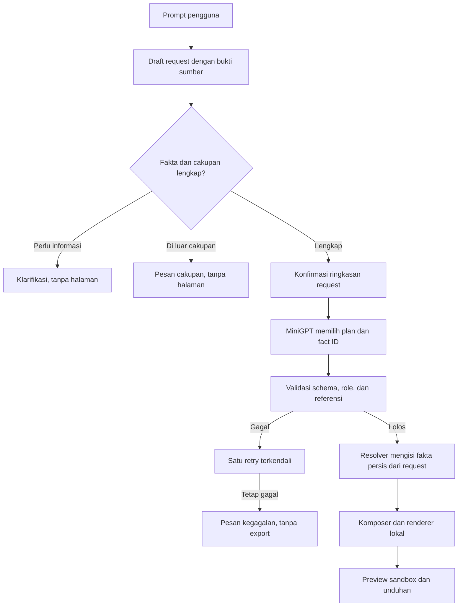

# Desain kontrak fakta terikat sumber untuk generasi halaman

Tanggal: 14 Oktober 2026

Status: pengguna menyetujui arah arsitektur. Tasks 1 sampai 3 sudah diimplementasikan; Task 4 sampai 10, data v5, dan training v5 belum dimulai.

Dokumen ini melanjutkan [desain generasi halaman lengkap](2026-10-13-full-page-generation-design.md). Perubahan utama adalah memisahkan fakta yang diberikan pengguna dari pilihan struktur dan presentasi yang dibuat MiniGPT.

## 1. Tujuan dan bukti saat ini

Target kualitas eksperimen adalah sedikitnya 76 dari 80 halaman development lolos kontrak. TRAIN-024 mendapat 68 dari 80. Pemeriksaan raw output pada RUN-380 menemukan 12 halaman gagal di enam keluarga nama. Nama berubah saat dihasilkan ulang di plan, navigasi, hero, atau about. Pasangan CSS biasa dan Tailwind pada keluarga yang sama sering menghasilkan kesalahan isi serupa. Ini mendukung hipotesis bahwa masalah utama ada pada penyalinan identitas dan fakta oleh model, bukan pada stylesheet.

Request sekarang sudah memiliki nama, deskripsi, dan setidaknya satu layanan. Plan serta isi section kemudian meminta model menuliskan kembali nilai itu. Validator menolak jika salinan tidak persis. Retry satu kali sudah digunakan, tetapi tidak selalu memperbaiki ejaan pada seluruh halaman.

Angka 95 persen adalah gate kelengkapan kontrak pada suite development sintetis. Angka itu tidak mengukur kualitas visual, kepuasan pengguna, atau kesiapan untuk prompt dunia nyata.

Bukti selection dan raw output tersimpan di [laporan v4](../../../reports/training/FULLPAGE-V4_DEVELOPMENT_SELECTION.json), [evaluasi TRAIN-024](../../../reports/fullpage/TRAIN-024_DEVELOPMENT_STEP3600.json), serta [RUN-380](../../../logs/RUN-380_train_024_development_failure_trace_rerun.txt).

## 2. Sasaran dan batas

Desain ini bertujuan untuk:

- Mempertahankan fakta usaha persis seperti sumber request.
- Membiarkan MiniGPT memilih susunan, peran section, variasi layout, aset, dan interaksi dari katalog proyek.
- Menolak request yang tidak lengkap, tidak didukung, atau tidak muat tanpa mengarang fakta atau memotong input diam-diam.
- Mempertahankan validator ketat dan mengekspor halaman hanya setelah semua stage lolos.
- Menilai kontrak baru pada 80 request development yang sama, dengan keluarga train, development, dan final tetap terpisah.

Di luar perubahan ini: antarmuka aplikasi penuh, deployment, backend, autentikasi, JavaScript bebas dari model, dukungan React/Vue, serta evaluasi final. Tahap UI input, preview, dan unduhan tetap dikerjakan setelah model mencapai gate dan secara terpisah dirancang.

## 3. Arsitektur yang dipilih

### 3.1 Request sebagai sumber kebenaran

Runtime model menerima request terstruktur, bukan teks chat tanpa batas. Untuk request ini, field yang diwajibkan mengikuti validator saat ini: genre yang didukung, style CSS biasa atau Tailwind, tepat satu fakta nama, tepat satu deskripsi, sedikitnya satu layanan, asset ID dari katalog, dan field lain yang sesuai schema.

Untuk UI prompt bebas yang dibuat pada tahap aplikasi kelak, PromptIntake menghasilkan `RequestDraft`. Setiap nilai faktual di draft harus menunjuk rentang teks sumber yang persis dari prompt. Validator memeriksa bahwa rentang tersebut cocok dengan nilai yang diekstrak. Jika nama, deskripsi, atau layanan tidak punya bukti sumber, sistem meminta pengguna melengkapi atau mengoreksinya.

Jika pengguna mengonfirmasi atau mengedit field yang tidak punya rentang sumber langsung, nilai itu menjadi input pengguna yang disetujui. Tebakan model tidak diterima diam-diam sebagai fakta.

Sebelum generation, UI menampilkan ringkasan request terstruktur untuk dikonfirmasi atau diedit. Setelah pengguna menyetujuinya, request menjadi sumber kebenaran untuk satu proses generation. Sistem tidak menciptakan nama, deskripsi, atau layanan sebagai pengganti.

### 3.2 Keluaran model versi baru

Kontrak versi baru memakai schema dan manifest terpisah dari PlanSpec dan SectionSpec lama agar checkpoint serta artefak historis tetap dapat direproduksi.

MiniGPT mengeluarkan PagePlan yang memuat urutan section, role, jenis komponen, variasi layout, asset ID, dan ID fakta yang dipakai. Metadata `title`, `genre`, dan `style_mode` tidak disalin dari model. Komposer membacanya dari request yang telah divalidasi.

SectionDraft merujuk fakta memakai `fact_id`, bukan menyalin nilai faktanya. Pada versi awal, teks faktual seperti nama merek, layanan, deskripsi, kontak, harga, dan testimoni dirender verbatim dari fakta tersebut. MiniGPT masih memilih bagian mana yang menonjol, bagaimana bagian disusun, dan pilihan template copy atau CTA nonfaktual yang didefinisikan di katalog berversi untuk kontrak baru.

Versi awal tidak meminta model menulis paragraf faktual bebas. Batas ini mengurangi kebebasan copy, tetapi menghindari klaim yang tidak dapat ditelusuri ke request. Copy bebas dapat ditambahkan kemudian setelah ada desain grounding dan evaluasinya sendiri.

### 3.3 Resolver, komposer, dan renderer

Resolver memeriksa bahwa setiap `fact_id` dikenal, diizinkan untuk role tersebut, dan tidak duplikat. Komposer membentuk PageSpec dengan menempatkan nilai request pada slot fact-reference. Renderer menghasilkan HTML, CSS biasa atau Tailwind, serta interaksi JavaScript dari katalog lokal.

Resolusi fact-reference adalah bagian resmi dari kontrak renderer, bukan perbaikan terhadap raw text model. Sistem tidak mengganti ejaan atau memperbaiki JSON yang salah. Reference yang hilang, tidak dikenal, tidak cocok dengan role, atau schema-invalid menyebabkan stage gagal.

PlanSpec dan SectionSpec lama tetap dibaca oleh jalur historis. Keluaran baru memakai versi schema dan renderer baru yang dipilih secara eksplisit dari metadata artefak.

## 4. Prompt tidak jelas, aneh, atau di luar cakupan

Pipeline sekarang bekerja pada request terstruktur. Aplikasi input teks bebas belum dibuat. Saat intake tersebut dirancang, ia harus membuat draft request dengan bukti sumber dan menampilkan ringkasan untuk konfirmasi. UI menggunakan status berikut; `needs_clarification`, `unsupported_request`, `input_too_long`, dan `ready` terjadi sebelum generation, sedangkan `generation_failed` dan `completed` menggambarkan hasil sesudah generation dimulai.

Sebelum UI intake tersedia, generator saat ini tetap menerima request terstruktur. Kegagalan fakta wajib dilaporkan sebagai `missing_information`; kegagalan kontrak model setelah retry dilaporkan sebagai `stage_failed`. UI kelak memetakan kondisi tersebut ke status yang mudah dipahami pada tabel berikut.

| Kondisi | Status UI | Yang dilihat pengguna |
| --- | --- | --- |
| Nama, deskripsi, layanan, genre, atau style belum jelas | `needs_clarification` | Satu pertanyaan ringkas tentang field yang kurang. Tidak ada preview atau file. |
| Permintaan bukan landing page/company profile, atau butuh backend/teknologi yang belum didukung | `unsupported_request` | Penjelasan cakupan dan contoh permintaan yang didukung. Tidak ada preview atau file. |
| Request terstruktur melampaui budget konteks | `input_too_long` | Saran untuk meringkas request. Input tidak dipotong diam-diam. |
| Prompt aneh dari sisi tema tetapi masih meminta jenis halaman dan komponen yang didukung, dengan fakta wajib lengkap | `ready` | Ringkasan fakta dan tema ditampilkan untuk konfirmasi. Setelah pengguna menyetujui, generation dilanjutkan. Keanehan tema sendiri bukan alasan penolakan. |
| Model tetap gagal memenuhi kontrak setelah satu retry | `generation_failed` | Pesan bahwa halaman belum dapat dibuat dan bagian umum yang gagal. Tidak ada preview atau file. Detail raw tetap di log internal. |
| Seluruh stage dan pemeriksaan komposisi lolos | `completed` | Preview sandbox serta berkas HTML, CSS, dan JavaScript hasil renderer. |

Instruksi yang meminta model mengabaikan aturan, membuka prompt internal, menjalankan JavaScript bebas, mengakses backend, atau memuat script eksternal tidak mengubah kontrak. Bagian yang di luar cakupan tidak dijalankan. Jika permintaan inti bergantung pada kemampuan itu, intake mengembalikan `unsupported_request`.

Jika ada request website yang valid tetapi satu informasi wajib hilang, sistem bertanya dahulu. Contoh: “Saya bisa membuat company profile, tetapi masih memerlukan nama usaha, deskripsi, dan layanan utama. Apa informasi tersebut?” Untuk permintaan yang hanya berbunyi “buat website”, tidak ada kode yang dibuat sampai jenis halaman dan isi pokok tersedia. Untuk prompt jelas, ringkasan request tetap ditampilkan agar pengguna dapat mengoreksi hasil intake sebelum generation.

Contoh tema aneh tetapi masih didukung: “Buat company profile studio keramik dengan nuansa luar angkasa.” Jika fakta wajib lengkap dan layout dapat diwakili katalog komponen, model dapat membuat halaman dengan aset serta variasi yang tersedia. Sistem tidak menjanjikan animasi atau perilaku visual yang tidak ada di renderer.

## 5. Data dan training yang direncanakan

- Bentuk ulang target fullpage v4 dengan schema baru menggunakan keluarga train saja. Keluarga development dan final tidak pernah menjadi sumber target training.
- Pertahankan pembagian family, request development, dan request final yang sudah dibekukan. Hash validation/test harus diverifikasi sebelum dan sesudah persiapan data.
- Tandai target sintetis sebagai belum ditinjau manusia. Laporkan jumlah row, panjang prompt/target, referensi fakta, retry, dan asal setiap target.
- Warm-start yang diusulkan adalah snapshot bobot TRAIN-024, dengan optimizer, scheduler, dan RNG baru. Catat eksperimen sebagai fine-tuning kontrak baru, bukan exact resume. Tidak mengubah checkpoint TRAIN-024.
- Usulan budget awal adalah 3.600 update dengan checkpoint development di 1.800 dan 3.600. Pertahankan context 2.048, output plan maksimum 512, section maksimum 1.536, microbatch 8, akumulasi 6, effective batch 48, dan plan sampling 0,7 untuk isolasi kontrak. Validasi token budget serta headroom storage sebelum training.
- Pilih kandidat dari jumlah halaman development yang lolos kontrak dan pemeriksaan exact fact-reference. Cross entropy menjadi metrik pendukung. Target tetap minimal 76/80. Final tidak dibuka untuk pemilihan.

## 6. Penerimaan dan batas bukti

Kontrak baru layak melanjutkan tahap model bila:

1. Semua request training dan evaluasi lolos validasi schema serta memiliki fakta minimum.
2. Semua slot faktual halaman terselesaikan dari ID request yang valid. Nilai hasil render sama persis dengan sumber fakta.
3. Tidak ada ID fakta atau aset yang tidak dikenal, role wajib yang hilang, anchor rusak, atau interaksi di luar katalog.
4. Keluaran tidak memuat JavaScript bebas dari model. Preview berjalan dalam sandbox; unduhan hanya tersedia setelah halaman diterima.
5. Candidate mencapai minimal 76/80 halaman development lengkap. Laporkan per genre dan style, serta first-attempt acceptance dan retry.
6. Prompt intake menunjukkan `needs_clarification`, `unsupported_request`, `input_too_long`, dan `generation_failed` tanpa membuat halaman atau berkas setengah jadi.

Gate 76/80 hanya membuktikan kontrak pada suite sintetis development. Browser review, penilaian visual manusia, uji prompt pengguna nyata, dan final benchmark tetap gate terpisah.

## 7. Risiko dan trade-off

- Copy faktual yang berasal langsung dari request lebih akurat, sementara pilihan kata bebas MiniGPT berkurang.
- Dataset tetap sintetis dan belum ditinjau manusia. Kelulusan schema bukan jaminan halaman terlihat bagus atau copy terasa alami.
- Intake bebas masih dapat salah menafsirkan prompt. Field penting harus dikonfirmasi atau diminta ulang, bukan diisi dengan tebakan model.
- Source-binding memberi nilai hanya jika semua slot dan template tervalidasi. Reference yang salah tetap harus menggagalkan generation.
- Memakai suite development yang sama mendukung perbandingan dengan TRAIN-024, tetapi tidak menggantikan evaluasi final atau review manusia.

## 8. Gerbang berikutnya

Pengguna menyetujui arah spesifikasi di chat sebelum rencana implementasi dibuat. Rencana implementasi memecah pekerjaan untuk versi schema baru, target train-only, evaluator, composer/renderer, input status, notebook, warm-start terpisah dari exact resume, dan gate development. Belum ada code, data, schema, prompt, konfigurasi, checkpoint, training, atau UI yang diubah oleh dokumen ini.
