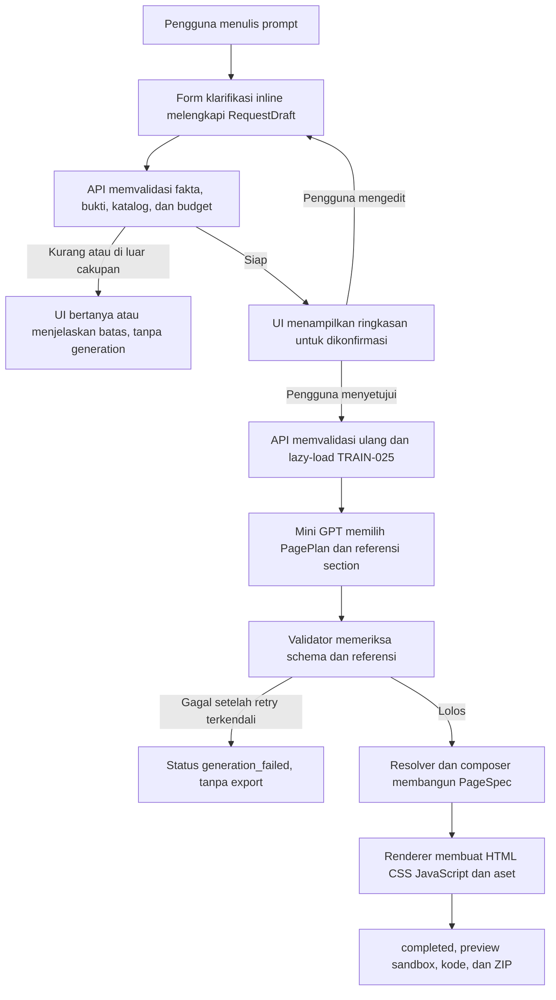

# Desain aplikasi chat untuk generator website Mini GPT

Tanggal: 15 Oktober 2026

Status: spesifikasi dan rencana implementasi disetujui pengguna pada 15 Oktober 2026. Implementasi source Task 1-5 sudah dikerjakan pada branch `feature/pipeline-data-model-training`. Build, server, review browser, end-to-end, dan inference aplikasi belum dijalankan.

Dokumen ini menetapkan lingkup, pengalaman pengguna, batas model, dan kontrak integrasi aplikasi website generator. Dokumen ini meneruskan pipeline source-bound yang telah dipilih untuk TRAIN-025.

## 1. Tujuan

Membuat aplikasi lokal yang memungkinkan pengguna meminta landing page atau company profile melalui antarmuka chat. Aplikasi mengumpulkan fakta yang belum tersedia, menampilkan ringkasan untuk dikonfirmasi, meminta pipeline membuat satu halaman utuh, memvalidasi hasil, lalu menyediakan preview serta unduhan berkas.

Pengalaman chat mengambil pola percakapan dan panel kerja dari [shadcn chatbot template](https://github.com/shadcn-ui/chatbot-template) dan [AI SDK Chatbot](https://chatbot.ai-sdk.dev/). Aplikasi menggunakan Next.js dan shadcn untuk UI serta FastAPI untuk menghubungkan UI ke pipeline lokal. Referensi tersebut menjadi acuan pengalaman penggunaan, bukan kewajiban memakai AI Gateway, model cloud, autentikasi, database, atau layanan penyimpanan dari penyedia lain.

## 2. Bukti dan batas model saat ini

Kandidat development yang dipilih adalah TRAIN-025 pada step 1.800. Laporan development mencatat 80 dari 80 halaman selesai, seluruh role wajib tersedia, pemeriksaan fakta, tautan, dan aset lulus, serta `model_gate=true`. Development CE 0,004538349198307462 lebih rendah dari kandidat TRAIN-026 step 3.600. Data test dan final tidak digunakan. Pemeriksaan browser serta review visual manusia masih berstatus pending.

Hasil ini membuktikan pipeline memenuhi kontraknya pada 80 request development yang dipakai untuk seleksi. Hasil tersebut tidak membuktikan kualitas visual 95 persen, mutu prompt dunia nyata, atau kesiapan produksi.

Model dan renderer saat ini tidak mempunyai kontrak untuk menulis HTML, CSS, JavaScript, atau paragraf copy faktual secara bebas. Model memilih plan halaman, peran section, tema, dan referensi ID fakta atau aset yang diizinkan. Resolver serta composer memeriksa referensi itu. Renderer lokal menghasilkan HTML, CSS biasa atau Tailwind, dan JavaScript dari interaksi yang tersedia di katalog. Copy nonfaktual memakai katalog copy lokal. Fakta usaha berasal dari request yang telah dikonfirmasi pengguna.

Akibatnya, aplikasi dapat menghasilkan halaman lengkap dengan struktur dan isi yang dirangkai dari fakta pengguna serta katalog proyek. Aplikasi tidak boleh menyebut hasilnya sebagai kode arbitrer yang ditulis model, dan tidak boleh mengarang nama usaha, layanan, harga, testimoni, atau klaim bisnis.

## 3. Lingkup versi pertama

### Termasuk

- Jenis halaman: `landing_page` dan `company_profile`.
- Gaya hasil: `plain_css` dan `tailwind`.
- Antarmuka chat lokal berbahasa Indonesia dengan form klarifikasi yang muncul di percakapan.
- Ringkasan request terstruktur yang dapat diedit dan harus dikonfirmasi sebelum generation.
- Pemanggilan pipeline lokal melalui API FastAPI.
- Validasi intake, output model, fakta, role, tautan, aset, serta komposisi sebelum halaman diterima.
- Preview sandbox, panel kode HTML/CSS/JavaScript, dan unduhan berkas hasil renderer.
- Riwayat percakapan di penyimpanan browser perangkat pengguna.
- Artefak pemilihan TRAIN-025 dalam folder training terpisah, dengan model dan output lokal tetap diabaikan Git.

### Tidak termasuk

- Backend atau database yang dibuat oleh model, autentikasi, akun, kolaborasi, atau deployment publik.
- Generator React, Vue, atau framework frontend lain.
- HTML, CSS, JavaScript bebas yang ditulis atau dijalankan langsung oleh model.
- Script CDN, script eksternal, koneksi keluar, dan form website yang benar-benar mengirim data.
- Inferensi otomatis dari prompt ketika data bisnis belum ada atau belum dikonfirmasi.
- Perubahan training, dataset, checkpoint terpilih, atau pemakaian data final.
- Klaim kualitas visual 95 persen sebelum review browser dan manusia selesai.

## 4. Pengalaman pengguna

### 4.1 Percakapan dan klarifikasi

Halaman awal menyediakan composer prompt dan beberapa contoh permintaan. Setelah prompt dikirim, UI menampilkan pesan pengguna lalu meminta API memvalidasi intake. Jika informasi belum lengkap, UI menampilkan kartu klarifikasi tepat di percakapan. Pengguna dapat mengisi atau mengoreksi nama usaha, deskripsi, layanan, fakta tambahan, jenis halaman, gaya CSS, aset, dan status usaha fiktif sesuai field yang diwajibkan schema.

Nilai yang tidak dapat dibuktikan dari rentang prompt harus ditandai sebagai nilai yang dikonfirmasi pengguna. Sistem tidak menerima tebakan model sebagai fakta. Setelah semua field tersedia, UI menampilkan ringkasan yang bisa diperiksa sebelum tombol **Buat halaman** diaktifkan.

Setiap percakapan dan riwayat di versi pertama tersimpan di `localStorage` perangkat. Backend tidak menyimpan akun atau database chat. ID generation dan informasi pemulihan hasil berasal dari berkas lokal di folder output aplikasi.

### 4.2 Generation dan status

Generation baru dimulai setelah pengguna mengonfirmasi ringkasan. API memeriksa request kembali, baru kemudian memuat model secara lazy dan menjalankan pipeline. UI menampilkan status menunggu yang jujur. Versi pertama menggunakan JSON request/response biasa, bukan token streaming atau progres stage yang dibuat-buat.

Jika intake, model, resolver, composer, atau renderer gagal, UI menampilkan pesan yang dapat dipahami, bagian umum yang perlu diperbaiki, dan tindakan untuk kembali mengedit request. Tidak ada preview atau unduhan untuk hasil yang gagal atau parsial.

### 4.3 Preview dan kode

Ketika hasil berstatus `completed`, tampilan kerja menyediakan:

- Preview responsif halaman.
- Pilihan ukuran layar desktop dan mobile untuk memeriksa tampilan.
- Tab kode `index.html`, `styles.css`, dan `app.js`.
- Tombol unduh berkas terpisah dan satu ZIP yang menyertakan aset serta atribusinya.
- Ringkasan fakta dan gaya yang dipakai, agar pengguna dapat memastikan hasil sesuai request.

Preview dijalankan dalam iframe dengan sandbox dan tanpa akses `same-origin`. Preview hanya menerima HTML, CSS, JavaScript, dan aset yang dibuat renderer lokal. Interaksi yang tersedia tetap terbatas pada katalog pipeline. Form kontak pada halaman hasil adalah demonstrasi lokal dan tidak mengirim pesan.

## 5. Alur sistem



Tahap intake tidak membuat halaman. Generasi hanya dimulai melalui tindakan eksplisit pengguna setelah ringkasan dikonfirmasi. Model tidak mengubah request sumber dan tidak menulis berkas web secara langsung.

## 6. Arsitektur aplikasi

```text
apps/
  web/                         Next.js App Router, TypeScript, shadcn UI
  api/                         FastAPI adapter, skema dan OpenAPI
training/
  selected/
    fullpage-v5/
      README.md                provenance, cara memilih model, batas evaluasi
      selection.json           salinan metadata seleksi dan digest
      model/                   checkpoint lokal, diabaikan Git
      development-output/      sampel development terpilih, diabaikan Git
outputs/
  webapp/
    generations/               request, report, serta website yang dihasilkan
src/fullpage/                  pipeline training dan renderer tetap di jalur asal
checkpoints/                   checkpoint kanonis tetap di jalur asal
```

`apps/web` menyediakan layout chat, kartu klarifikasi, panel hasil, preview, kode, serta riwayat lokal. Tampilan memakai shadcn dan Tailwind. Paket UI adalah presentasi produk; Tailwind compiler website hasil generation tetap milik renderer pipeline.

`apps/api` berisi adapter FastAPI yang memanggil `prepare_intake`, `FullPageGenerator`, dan renderer yang telah ada. API tidak mengimplementasikan ulang validator, prompt model, resolver, atau renderer.

`training/selected/fullpage-v5` menjadi paket lokal yang mudah ditemukan dan memiliki manifest provenance. Salinan lokal model serta output development dibuat setelah gerbang implementasi disetujui, diverifikasi terhadap SHA-256 manifest, dan dikecualikan dari Git. Artefak kanonis di `checkpoints/` dan `outputs/fullpage/` tidak dipindahkan atau ditimpa. Source training yang sudah tercermin di lineage checkpoint tidak diubah dalam pekerjaan UI/API tanpa desain eksperimen tersendiri.

FastAPI memakai environment Python proyek yang sudah berisi PyTorch CUDA agar tidak menggandakan instalasi framework GPU. Dependensi API dicatat terpisah dan dipasang hanya setelah spesifikasi serta rencana disetujui. Next.js memakai environment Node proyek. Versi dependensi konkret dipilih dan dikunci pada tahap rencana implementasi.

## 7. Kontrak API awal

API memakai JSON dan skema bertipe. FastAPI menerbitkan dokumen OpenAPI dari implementasi kontrak di `/openapi.json` dan halaman referensi lokal `/docs`. Dokumentasi mencantumkan contoh request, cabang status, serta contoh error. Frontend menggunakan base URL dari environment lokal, bukan URL yang ditulis tersebar di komponen.

### Rute

| Metode dan path | Tujuan | Efek samping |
| --- | --- | --- |
| `GET /api/v1/health` | Cek API, versi kontrak, dan apakah model telah dimuat | Tidak memuat model |
| `GET /api/v1/catalog` | Mengambil genre, gaya, fitur, serta aset yang tersedia | Tidak memuat model |
| `POST /api/v1/intake/validate` | Memvalidasi prompt dan `RequestDraft`; mengembalikan klarifikasi, cakupan, atau status siap | Tidak membuat halaman dan tidak memuat model |
| `POST /api/v1/generations` | Memvalidasi ulang request terkonfirmasi lalu menjalankan generation | Satu output lokal hanya jika renderer sukses |
| `GET /api/v1/generations/{generation_id}` | Mengambil ringkasan hasil yang aman untuk riwayat lokal | Tidak memuat model |
| `GET /api/v1/generations/{generation_id}/preview/{relative_path:path}` | Menampilkan `index.html` yang diterima dan file CSS, JavaScript, serta aset lokal yang dirujuknya | Hanya membaca output allowlist |
| `GET /api/v1/generations/{generation_id}/source` | Mengambil sumber HTML/CSS/JS untuk tab kode | Hanya membaca output allowlist |
| `GET /api/v1/generations/{generation_id}/download.zip` | Mengunduh hasil renderer dan aset yang terkait | Membaca berkas generation tersebut saja |

### Request intake

`POST /api/v1/intake/validate` menerima `prompt` serta `draft`. `draft` mengikuti `request-draft-source-bound-v1`, termasuk versi kontrak, prompt yang sama persis, genre, gaya, fakta usaha, fitur yang diminta, aset, status fiktif, dan bukti sumber atau konfirmasi untuk setiap fakta.

Contoh request ringkas:

```json
{
  "prompt": "Buat landing page untuk studio keramik dengan nuansa hangat.",
  "draft": {
    "contract_version": "request-draft-source-bound-v1",
    "prompt": "Buat landing page untuk studio keramik dengan nuansa hangat.",
    "genre": "landing_page",
    "style_mode": "tailwind",
    "business_facts": [
      {"id": "nama-usaha", "kind": "name", "value": "Ruang Tanah", "evidence": {"user_confirmed": true}},
      {"id": "deskripsi", "kind": "description", "value": "Studio keramik untuk kelas dan karya pesanan.", "evidence": {"user_confirmed": true}},
      {"id": "layanan-kelas", "kind": "service", "value": {"title": "Kelas keramik", "title_evidence": {"user_confirmed": true}, "text": "Kelas untuk pemula.", "text_evidence": {"user_confirmed": true}}}
    ],
    "requested_features": [],
    "asset_ids": [],
    "fictitious": true
  }
}
```

Response intake memiliki `status`, `message`, `missing_fields`, dan `request` hanya jika request siap. Status UI yang stabil adalah `needs_clarification`, `unsupported_request`, `input_too_long`, dan `ready`. Detail error internal validator tidak dikirim sebagai pesan mentah ke pengguna.

### Request generation dan hasil

`POST /api/v1/generations` menerima `prompt` dan `RequestDraft` yang sama seperti validasi intake, lalu server mengulang `prepare_intake` sebelum model dijalankan. Generator hanya menerima objek request internal hasil validasi server. Hasil sukses memiliki status `completed`, ID generation, jumlah section yang diterima, URL preview yang berakhir dengan `/preview/index.html`, URL ZIP, serta daftar nama sumber yang tersedia. Endpoint source mengembalikan hanya `index.html`, `styles.css`, dan `app.js`.

Hasil gagal memakai status UI `generation_failed` atau `input_too_long`, pesan aman, dan daftar field/action yang relevan jika tersedia. Raw output model, prompt internal, path absolut, dan traceback tidak dikirim ke browser. Expected workflow status dibedakan dari error transport atau service, yang menggunakan kode HTTP sesuai OpenAPI.

### Runtime dan konkurensi

- Generation versi pertama berjalan sebagai satu operasi JSON biasa. Tidak ada token streaming palsu.
- Model dimuat secara lazy pada proses pertama yang menjalankan generation, bukan oleh health, catalog, atau intake.
- Server berjalan sebagai satu worker lokal agar bobot tidak diduplikasi ke VRAM RTX 5070. Generation paralel dibatasi satu per waktu.
- API di-bind ke loopback. CORS hanya mengizinkan origin frontend lokal yang dikonfigurasi.
- Browser hanya mengirim `generation_id`, bukan path filesystem. Semua pembacaan file memeriksa bahwa path tetap berada di direktori generation yang diizinkan.
- Berkas output ditulis ke direktori unik. Output generation yang sudah ada tidak ditimpa.

## 8. Keamanan, batas data, dan bukti

- Model tidak dapat mengirim HTML, CSS, JavaScript, atau instruksi shell langsung ke renderer. Schema dan katalog adalah batas kemampuan.
- Preview menggunakan iframe sandbox tanpa `allow-same-origin`; preview hanya memuat sumber dan aset lokal dari generation yang diterima.
- API tidak mengekspos file arbitrer, file checkpoint, file data training, atau isi internal model.
- Prompt, RequestDraft, plan, hasil, metadata checkpoint, dan aset lokal disimpan di folder proyek yang diabaikan Git. Tidak ada upload ke layanan AI cloud.
- Riwayat percakapan berada di browser lokal dan dapat dihapus pengguna dari perangkat itu. Penghapusan riwayat browser tidak menghapus output proyek; output lokal dikelola terpisah.
- Log tidak merekam API key, password, token, atau informasi pribadi yang tidak diperlukan. Kegagalan teknis dicatat di sisi server dengan ID generation agar dapat ditelusuri.
- Review visual browser dan manusia adalah gerbang terpisah. Kelulusan validator tidak boleh disebut sebagai skor visual.

## 9. Kriteria penerimaan desain

Implementasi setelah persetujuan spesifikasi harus memenuhi kondisi berikut:

1. Chat mengumpulkan informasi lewat form inline dan meminta konfirmasi ringkasan sebelum generation.
2. Fakta yang tidak memiliki bukti prompt ditandai sebagai konfirmasi pengguna. Sistem tidak mengisi fakta kosong dengan tebakan.
3. Intake yang belum lengkap atau di luar cakupan tidak memuat model, tidak menghasilkan berkas, dan menampilkan tindakan koreksi yang jelas.
4. Backend meneruskan request ke pipeline yang ada dan menjalankan kembali validasi sebelum inference.
5. Generation gagal tidak menyediakan preview, source tabs, atau ZIP parsial.
6. Generation berhasil menyediakan preview sandbox, HTML/CSS/JS, serta unduhan ZIP dengan aset yang dibuat renderer.
7. UI dan OpenAPI mendokumentasikan status serta batas fitur secara konsisten.
8. Model hanya dimuat saat diminta, proses menggunakan satu worker, API dibatasi ke loopback dan origin frontend lokal.
9. Paket TRAIN-025 memiliki provenance dan hash. Salinan model serta output development lokal diabaikan Git, sementara artefak kanonis tidak berubah.
10. Belum ada inferensi aplikasi selama penulisan spesifikasi atau scaffolding awal. Demo generation baru dijalankan setelah pengguna meminta tahap tersebut secara terpisah.

Kriteria ini mendefinisikan desain, bukan bukti implementasi. Tidak ada test, generation, review browser, atau perubahan training yang dilakukan dalam tahap spesifikasi.

## 10. Risiko dan keputusan yang tetap ditunda

- TRAIN-025 lulus validator development tetapi belum menjalani review visual. Tampilan chat dapat dipoles tanpa mengubah skor kualitas halaman.
- Katalog copy membatasi fleksibilitas kata-kata. Copy bebas faktual memerlukan desain grounding dan evaluasi tersendiri.
- Operasi generation sinkron mungkin membutuhkan waktu lebih lama dari batas proxy/browser tertentu. Jika masalah itu terbukti saat implementasi lokal, desain job API asinkron harus ditinjau sebagai perubahan spesifikasi sebelum ditambahkan.
- Riwayat di `localStorage` tidak disinkronkan antarpiranti dan dapat hilang bila data browser dibersihkan.
- Detail visual seperti palet final, logo aplikasi, ikon, animasi, dan layout mobile akan ditetapkan melalui panduan UI saat rencana implementasi dibuat. Semua kontrol tetap harus mengikuti keputusan UX, keamanan, dan kontrak di dokumen ini.

## 11. Referensi teknis

- [shadcn chatbot template](https://github.com/shadcn-ui/chatbot-template)
- [AI SDK Chatbot](https://chatbot.ai-sdk.dev/)
- [Next.js App Router](https://nextjs.org/docs/app)
- [shadcn/ui untuk Next.js](https://ui.shadcn.com/docs/installation/next)
- [FastAPI dan OpenAPI](https://fastapi.tiangolo.com/tutorial/first-steps/)
- [FastAPI CORS](https://fastapi.tiangolo.com/tutorial/cors/)
