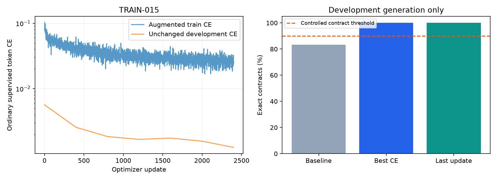

# Kelanjutan kualitas penyalinan

AI-013, 13 Oktober 2026. Eksperimen TRAIN-015 memakai model proyek14.186.496parameter dari bobot acak proyek, parent TRAIN-012 best. Tidak memakai pretrained LLM eksternal.

Dokumen dan notebook08 merekam fase development sebelum evaluasi final. Status terbaru sesudah fase berikutnya dicatat terpisah di README dan laporan gerbang final.

## Data dan diagnosis

TRAIN-013 last name16x menghasilkan23/24schema dan20/24exact pada development, dengan satu token_limit. Diagnosis baseline menemukan kesalahan nama pada empat contoh, dan satu potongan hanya memiliki dua exposure row train. Frekuensi ini dihitung pada train.

V6 menambah **21,090 row train**, total **40,158**. Dari 3,903 potongan langka yang dicoba, 1,327 mendapat konteks targeted baru. Sebanyak 20,679 varian judul ditolak/dilewati karena batas generator, BPE membership atau nama. Tidak mengklaim seluruh vocabulary sudah terwakili dalam konteks baru. Semua data tambahan sintetis dengan human_reviewed=False.

Validation1.440/test1.440/final48 dipertahankan byte-identik terhadap v5. Final belum dievaluasi. Pemeriksaan hashes tidak membaca target final untuk tuning. Nama baru dicegah mengulang brand historis melalui hash membership pada semua prefix. [Manifest v6](data/SYNTHETIC_CURRICULUM_V6.json).

## Training dan hasil aktual

Budget tetap2.400update, batch48, BF16, ordinaryCE, LR5e-5ke5e-6, SDPA/fusedAdamW. [Probe v6](training/GPU-PERF-005.json) mengonfirmasi batch sebelum training; bobot probe dibuang. Waktu trainer 481.44detik, 46,345,118 label target termasuk pengulangan. Throughput setelah lima update awal 101,569token target/detik. Peak allocated/reserved 6.67/7.49GiB. Sisa storage 17.73GiB, reserve15GiB.

| Checkpoint | Step | Schema development | Exact development | Full validation CE |
| --- | --- | --- | --- | --- |
| Baseline TRAIN-012/14 best | 3.600/0 | 24/24 | 20/24 | 0.00565869 |
| TRAIN-015 best | 2400 | 24/24 | 24/24 | 0.00125934 |
| TRAIN-015 last | 2400 | 24/24 | 24/24 | 0.00125934 |

Best dipilih berdasarkan full validation ordinaryCE sesuai aturan sebelum training. Pengukuran best/last generation merupakan diagnosis development. Final tetap tertutup; tidak memilih checkpoint dengan mencoba final berulang. Backend training SDPA dan evaluator manual dapat menghasilkan beda numerik kecil.

Data, learning rate dan budget berbeda dari TRAIN-014. Ini eksperimen kelanjutan yang telah ditetapkan, bukan ablation dengan budget identik. Peningkatan tidak dapat diatribusikan seluruhnya pada data tambahan.

## Batas dan langkah berikutnya

Runtime website tetap TRAIN-012 dengan hasil final historis43/48exact. Hasil development di atas belum membuktikan arbitrary prompt, layout baru atau kualitas browser. UI aplikasi tetap tahap setelah kualitas. Langkah berikutnya menetapkan kandidat dan aturan final sebelum satu evaluasi holdout, atau memperbaiki model/data jika development belum memadai.

[Log training](../logs/LOG_TRAINING.md), [log interaksi](../logs/interaksi_llm/AI-013_2026-10-13.md), [notebook08](../notebooks/08_kualitas_penyalinan_dan_training.ipynb), [summary aktual](training/TRAIN-015_copy_experiment.json), [rencana](../docs/superpowers/plans/2026-10-13-copying-quality-continuation.md).

