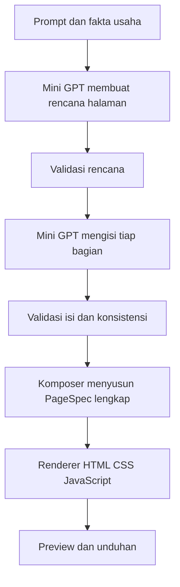

# AI-014: Usulan peningkatan halaman lengkap

## Status

Pengguna memprioritaskan landing page dan company profile. Dokumen ini adalah analisis dan usulan arah, belum spesifikasi yang disetujui atau hasil implementasi. Model tetap berasal dari random initialization, dengan HTML, CSS biasa atau Tailwind, serta JavaScript dari katalog. UI aplikasi tetap tahap akhir.

## Bukti

- RUN-193: 40.158 train row, terdiri dari 15.704 halaman dengan 3 bagian, 19.000 dengan 4 bagian dan 5.454 dengan 5 bagian. Tidak ada halaman lebih panjang dalam train v6.
- Model 14.186.496 parameter, konteks 1.024 token dan output budget 768. Prompt serta penanda juga menggunakan konteks.
- Schema v1 mengizinkan 16 bagian. Renderer memakai satu pola CSS bersama, belum memiliki kontrak aset gambar dan komposisi visual hero split.
- RUN-194: fixture manual gagal karena properti required pada field kontak tidak didukung. Snapshot dipertahankan. RUN-195 menghapus properti tersebut dari fixture dan memvalidasi keduanya. Kode produksi tidak diubah.

| Fixture manual, bukan output model | Bagian | Prompt dan penanda | Target | Total dengan EOS |
| --- | ---: | ---: | ---: | ---: |
| Landing page | 9 | 123 | 1.374 | 1.498 |
| Company profile | 9 | 121 | 1.357 | 1.479 |

Keduanya melampaui konteks dan output budget. Pengukuran menggunakan tokenizer proyek serta serialisasi appearance_before_sections. Fixture memakai sebagian besar text_section untuk mengikuti schema lama, bukan bukti kualitas visual atau batas panjang semua halaman. [Snapshot valid](analysis/AI-014_FULL_PAGE_SCOPE_VALID.json), [snapshot gagal](analysis/AI-014_FULL_PAGE_SCOPE.json).

TRAIN-015 sebelumnya mencapai 48/48 schema-valid dan 44/48 exact pada benchmark terkendali. Itu belum membuktikan halaman lengkap atau prompt bebas. Final tersebut sudah consumed dan tidak dipakai untuk tuning fase berikutnya.

## Pilihan pendekatan

| Pilihan | Manfaat | Biaya |
| --- | --- | --- |
| Rencana halaman lalu isi per bagian, direkomendasikan | Halaman panjang tidak harus dihasilkan dalam satu konteks; kegagalan dapat dilacak per bagian | Task data baru, komposer, konsistensi fakta, beberapa panggilan model |
| Satu generasi dengan konteks diperbesar | Runtime sederhana | Profil VRAM dan training baru; dua fixture tidak membuktikan konteks 2.048 cukup untuk seluruh halaman |
| Template tetap dengan isian model | Cepat dan susunan mudah dijaga | Kebebasan model memilih susunan serta variasi desain terbatas |

Perubahan data dan renderer dikerjakan bersama. Jumlah parameter atau konteks diperbesar jika hasil development dan profil sumber daya menunjukkan kebutuhan.

## Scope yang diusulkan

Landing page: navbar, hero dengan CTA, pengenalan, layanan atau produk, manfaat, proses, FAQ, kontak atau CTA akhir, footer. Harga dan testimoni hanya jika data tersedia.

Company profile: navbar, hero, profil, visi atau nilai, layanan, proyek atau portofolio jika tersedia, proses atau tim jika diminta dan ada datanya, kontak, footer. Bagian disesuaikan dengan permintaan dan informasi usaha.

Desain mencakup hero dengan visual, variasi kartu dan latar, tipografi terarah, serta layout desktop dan ponsel. Gambar menggunakan ID aset lokal dengan asal dan lisensi tercatat. Demo fiktif diberi penanda; tidak mengarang statistik, pelanggan atau testimoni perusahaan nyata.

## Flow

Rencana memuat genre, tema, urutan bagian dan pilihan layout dalam katalog. Task isi menerima ringkasan rencana, ID bagian dan fakta usaha yang sama. Komposer memeriksa nama, fakta, ID serta tautan sebelum menyatukan hasil. Kegagalan ditampilkan secara jelas, tidak diganti diam-diam dengan target training. Kontrak versi dan detail retry ditetapkan dalam spesifikasi berikutnya.

## Urutan dan evaluasi

1. Tetapkan kontrak plan, task bagian dan PageSpec baru dengan pembacaan v1 tetap tersedia.
2. Siapkan pilot halaman lengkap dengan provenance. Pisahkan sintetis dan reviewed manusia. Semua task turunan dari satu keluarga halaman harus berada dalam partisi yang sama.
3. Perluas validator, komposer dan renderer dengan variasi layout serta katalog aset.
4. Buat notebook baru dengan hasil antara. Profil GPU menentukan batch dan budget, mempertahankan reserve 15 GiB. Free disk saat pengukuran sekitar 17,73 GiB.
5. Training dengan development baru dan final baru yang dibekukan sebelum eksperimen. Nilai keluarga usaha serta kombinasi layout yang belum terlihat, bukan hanya nama berbeda.
6. Periksa halaman lengkap, desktop, ponsel dan interaksi sebelum integrasi UI aplikasi.

Usulan development gate: minimal 95% halaman selesai/schema-valid dan 95% mencakup bagian yang diminta. Semua halaman yang diterima harus memiliki tautan dan target interaksi valid serta mempertahankan fakta pengguna. Laporkan pelanggaran fakta terpisah dari validitas JSON.

Rubrik manusia menilai relevansi, pengulangan, hierarki, konsistensi visual dan variasi layout. Ambang rubrik ditetapkan sebelum final. Exact JSON tidak menjadi satu-satunya ukuran teks kreatif. Browser memeriksa overflow, keterbacaan, CTA, menu, FAQ dan formulir; audit statis tidak disamakan dengan bukti browser.

Formulir tetap validasi lokal hingga integrasi pengiriman dirancang terpisah. Log training mencatat hash data/config/checkpoint, seed, asal data, panjang task, durasi, VRAM, telemetry, stop reason serta kegagalan tiap tahap.

## Langkah berikutnya

Review arah ini, kemudian tulis spesifikasi konkret dan rencana implementasi. Skill brainstorming mensyaratkan review kontrak arsitektur sebelum implementasi. Belum ada TRAIN-016, data training baru atau kemampuan halaman lengkap yang dibuktikan dari analisis ini.
