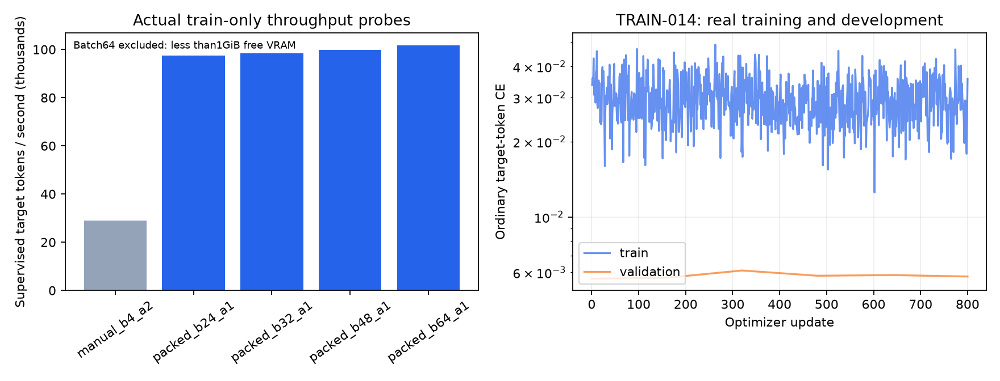

# Optimasi training RTX 5070

Sesi AI-012, 13 Oktober 2026. Tujuan: meningkatkan kecepatan training aktual pada GPU pengguna. Model proyek tetap memiliki 14.186.496 parameter dan berasal dari bobot acak proyek.

## Hasil training nyata

TRAIN-014 selesai 800 update, memproses 14.365.682 token target dalam 162,257 detik. Setelah lima update awal dikeluarkan, 795 update mencapai **99.200 token target/detik**, sekitar **3,43 kali** baseline probe sebesar 28.903. Angka peningkatan mengukur kecepatan update. Angka ini tidak menyatakan peningkatan kualitas atau keseluruhan waktu pipeline pada budget identik.

| Pengukuran | Hasil |
| --- | --- |
| GPU | RTX 5070, 12.227 MiB VRAM |
| VENV | CPython 3.11.9, PyTorch 2.14.1+cu130, CUDA 13.0, BF16 |
| Batch/context | Batch 48, accumulation 1, context 1.024 |
| Utilisasi GPU saat update, 256 sampel | Rata-rata 93,23%, maksimum 100% |
| Suhu saat update | Rata-rata 61,36°C, maksimum 67°C |
| Daya saat update | Rata-rata 195 W, maksimum 201,96 W |
| PyTorch peak allocated/reserved | 6,55 GiB / 6,67 GiB |
| Total memori nvidia-smi saat update | Rata-rata 8.669,87 MiB, maksimum 8.691 MiB, termasuk desktop |
| Sisa storage setelah run | 18,77 GiB, reserve 15 GiB |
| Kegagalan pada training | Tidak ada exception, OOM atau nonfinite |

Persentase berasal dari sampling nvidia-smi setiap 0,5 detik, dipilih berdasarkan waktu query yang berada dalam interval update. Window dan lag pengukuran GPU tidak identik dengan durasi kernel. Maksimum 100% tidak berarti terus-menerus 100%. CUDA free budget pada Windows/WDDM dan total memori fisik nvidia-smi dilaporkan secara terpisah.

## Empat sweep, bobot probe dibuang

Semua kandidat memakai contoh train yang diacak dari checkpoint TRAIN-012 best, enam warmup, lalu 40/200/100/100 update terukur pada sweep 1/2/3/4. Setiap kandidat berjalan dalam process baru. Pemilihan pengaturan performa hanya memakai data train. Batch berbeda memproses jumlah token dan contoh yang berbeda; JSON melaporkan token target/detik, token input/detik, dan contoh/detik.

| Tahap | Konfigurasi terpilih/temuan | Throughput targettokens/sec |
| --- | --- | --- |
| [GPU-PERF-001](training/GPU-PERF-001.json) | Manual4x2baseline; SDPA32x1; batch48slower/free0 | 28.223ke87.506 |
| [GPU-PERF-002](training/GPU-PERF-002.json) | 200update memastikan gainSDPA32; GPUmean93,2% | 29.006ke87.002 |
| [GPU-PERF-003](training/GPU-PERF-003.json) | Projectiontarget-only24; batch32reserved10,31GB/free0 | 28.877ke96.921 |
| [GPU-PERF-004](training/GPU-PERF-004.json) | Target-only+expandablesegments48; kandidat64ditolakheadroom | 28.903ke99.811 |

Batch 64 pada sweep 4 mencapai 101.755 token target/detik, tetapi sisa CUDA yang dilaporkan hanya 716.021.760 bytes, di bawah 1 GiB. Peningkatan 2% dibanding batch 48 tidak memenuhi syarat headroom; grid dihentikan sebelum batch 80. Batch 48 adalah konfigurasi tercepat yang memenuhi syarat dalam grid yang diukur. Hasil ini tidak menentukan maksimum teoretis semua kemungkinan hardware dan arsitektur.

## Perubahan runtime

1. Attention SDPA causal opsional dengan dropout 0 saat eval dan 0,1 saat train. Parameter, nama tensor, state_dict dan arsitektur checkpoint tetap kompatibel. Backend manual masih tersedia. Urutan numerik dan sampling dropout dapat berbeda.
2. Fused AdamW, BF16, TF32 opsional, pinned host memory dan transfer nonblocking.
3. Transformer tetap menerima seluruh context. Pada training, lm_head dan CE hanya memproyeksikan posisi hidden dengan label aktif. Prompt/padding tetap konteks dengan label -100; JSON/EOS tetap aktif dan label sudah digeser untuk next-token. Objective memakai ordinary CE, tanpa bobot nama 16 kali. Inference/evaluation tetap dapat memakai logits penuh.
4. Allocator `expandable_segments:True` berlaku dalam child process baru dan tercatat di config serta summary. Pada batch 32, reserved 10,31 GB di sweep 3 menjadi 5,01 GB di sweep 4. PyTorch menyebut pengaturan ini experimental. Pengaturan telah dijalankan pada mesin ini, dengan environment terbatas pada child process.
5. Telemetry tersimpan untuk startup, train, validation dan checkpoint. Ringkasan sampel update dipisahkan. Resume tetap membutuhkan config/data/lineage yang identik. Ganti batch atau setting melalui tahap continuation baru.

[Operator profiling aktual](training/GPU-PERF-001_attention_operators.json) mencatat scaled_dot_product_efficient_attention/CUTLASS BF16 forward/backward dan fused_adamw. Backend teramati adalah **memory-efficient attention**. Profiling mengamati satu update nyata pada batch 4 dan membuang bobot hasilnya.

## Kualitas model belum meningkat

Full validation CE awal 0,00565763, akhir 0,00577413. Best step 0 dipilih: 77 tensor model identik bitwise dengan parent TRAIN-012. [Generasi development](training/TRAIN-014-DEV_curriculum_evaluation.json) tetap 24/24 schema valid, 20/24 sesuai persis, dan semua berhenti pada EOS. Evaluator manual menghasilkan CE 0,00565869, sedikit berbeda dari trainer SDPA karena numerik backend dan batch. Bobot terpilih tetap sama.

**Optimasi throughput berhasil, kualitas checkpoint terpilih belum membaik.** Runtime website contoh tetap TRAIN-012 best. Final historis 43/48 exact masih di bawah threshold 90%. Final v5 tetap tertutup; bobot identik tidak dievaluasi pada final baru untuk mencari kelulusan. Kualitas browser, UI dan produksi belum dibuktikan pada tahap ini.

## Menjalankan training optimal

[Config](../configs/training_gpu_optimized.json), [log komprehensif](../logs/LOG_TRAINING.md), [notebook 07](../notebooks/07_optimasi_gpu_dan_training.ipynb), [report TRAIN-014](training/TRAIN-014.json), [performa](training/TRAIN-014_gpu_performance.json), dan [diagnosis pemilihan checkpoint](training/TRAIN-014_SELECTION_DIAGNOSTIC.json).

```powershell
.\.venv\Scripts\python.exe -m qa.run_logged --label train_gpu_optimized -- .venv/Scripts/python.exe -m qa.train_configured_gpu --initialize-from checkpoints/TRAIN-012/best.pt
```

Command memulai run/ID baru dan menyimpan artifacts baru. Config default launcher adalah training_gpu_optimized.json. Batch ini sudah diprofilkan untuk **curriculum PageSpec**, dengan prompt/padding masked. Profilkan kembali untuk pretraining code yang semua label tokennya aktif, atau ketika model/context/dataset/supervision/beban hardware berubah. Jika menurunkan batch, hitung validation_batches agar seluruh 1.440 validation rows tetap dipakai.



Referensi resmi: [SDPA](https://docs.pytorch.org/docs/stable/generated/torch.nn.functional.scaled_dot_product_attention), [AdamW](https://docs.pytorch.org/docs/stable/generated/torch.optim.AdamW), dan [CUDA allocator](https://docs.pytorch.org/docs/stable/notes/cuda). Keputusan performa didasarkan pada pengukuran lokal.
