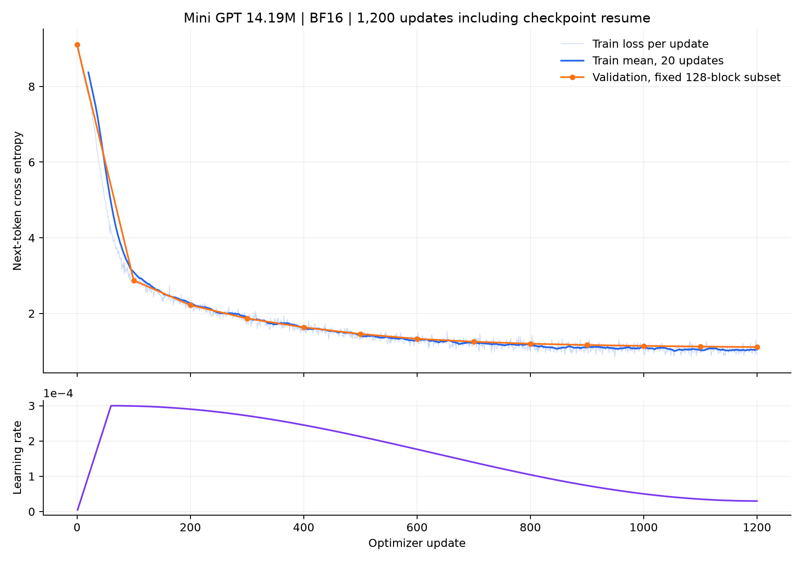

# Ringkasan Pipeline dan Training Mini GPT

Snapshot baseline 12 Oktober 2026. Status terbaru: [SFT pilot reviewed 13 Oktober 2026](SFT_PILOT_SUMMARY_2026-10-13.md), 40 update dan JSON valid 0/4. Pernyataan SFT belum dijalankan di bawah ini adalah kondisi historis saat laporan baseline dibuat.

Tanggal: 12 Oktober 2026. **Gerbang aplikasi: needs-data.** Pipeline data, model, loop training, checkpoint/resume, evaluasi token, serta probe generation tersedia. Pretraining aktual telah selesai; SFT belum dijalankan karena anotasi produksi belum direview.

## Hasil aktual

| Klaim | Hasil | Bukti |
| --- | --- | --- |
| Model proyek dari nol | 14.186.496 parameter; 6 layer / 6 head / embedding 384 / context1024 / vocab8192 | configs/model.json, TRAIN-001, RUN-055/056 |
| Data pretraining | 51.211 unik; train41.639 / val5.016 / test4.556; BPE train-only | [laporan data](STATUS_PIPELINE_2026-10-12.md), data/manifests/pipeline_summary.json |
| Smoke BF16 | 5 update finite, last/best/config tersimpan | [TRAIN-002](training/TRAIN-002.json), RUN-061 |
| Baseline dan resume GPU | TRAIN-003 step0-200, TRAIN-004 step201-1200; cursor800 menjadi4800 | [TRAIN-003](training/TRAIN-003.json), [TRAIN-004](training/TRAIN-004.json), RUN-062/064 |
| Total train token valid | 19.657.265 kumulatif, sekitar1,03 lintasan token train | TRAIN-004 total_train_tokens |
| Validation subset | Loss9,101529 awal menjadi1,111391; perplexity akhir3,038581 | 128 blok tetap dipilih seed59, 131.072 label per evaluasi |
| Test token penuh | Loss1,070987; perplexity2,918259; 2.074.051 label valid / 507 batches | [evaluasi](training/TRAIN-004_evaluation.json), RUN-066 |
| Generation PageSpec | JSON parseable0/4, schema valid0/4 pada probe buatan Indonesia | RUN-066, exploratory_unreviewed; bukan benchmark SFT reviewed |
| Unit/integration fixture | 49 tests lulus pada RUN-068; resume CPU identik bitwise dengan dropout | tests/, RUN-068 |
| GPU dan storage | Peak TRAIN-004 allocated2,03GiB / reserved2,20GiB; F sekitar25,50GiB bebas | TRAIN-004 dan storage akhir |

## Konfigurasi baseline

AdamW, batch4 / accumulation4, effective batch16 blok / maksimum16.384 token per update. LR0,0003; warmup60; cosine decay ke0,00003; betas0,9/0,95; weight decay0,1; gradient clipping1. BF16 pada RTX5070 / PyTorch2.14.1+cu130. Seed42; dropout0,1. Model memakai attention kausal dan learned positional embedding yang ditulis untuk proyek; tidak memakai nn.Transformer, pretrained tokenizer, atau bobot bahasa eksternal.

Validation/checkpoint setiap100 update menggunakan subset validation tetap. Checkpoint best dipilih sebelum membuka test. Test hanya dipakai untuk pelaporan akhir, tidak untuk menyesuaikan model atau hyperparameter. Deteksi family dan duplikasi semantik tetap memiliki batas heuristik seperti laporan data.

Waktu proses TRAIN-00347,244detik + TRAIN-004227,017detik =274,261detik, sekitar4,57menit. Ini tidak termasuk profiling, smoke, atau evaluasi. Median throughput per update77.932token/detik; bukan throughput keseluruhan termasuk checkpoint/evaluasi.

Kurva menampilkan train setiap update, rata-rata20update, dan validation subset pada13titik unik. Garis train/validation turun, tetapi hal ini belum membuktikan kepatuhan prompt-ke-PageSpec.

## Checkpoint dan reproducibility

Checkpoint lokal `checkpoints/TRAIN-004/best.pt`, step1200, dipilih lewat validation subset. SHA-256: `9f407be207c9b9090104d48243109a2c333d9609cd89e7584dd8ccd5d5b50486`. Last SHA-256: `9923d60cb5392e99974fcba5472291117c4bd795dbb5819e57e20cfbc23b5001`. Masing-masing170.347.289bytes.

Checkpoint memuat model, optimizer, scheduler, step, token count, RNG Python/NumPy/PyTorch/CUDA, sampler cursor, config, dan data/tokenizer lineage. Load memeriksa checksum sebelum mutasi model. Config snapshot dan sidecar checksum tetap lokal. Resume GPU memulihkan validation loss step200 yang sama persis dan melanjutkan cursor. Identik bitwise terhadap run tanpa jeda dibuktikan pada CPU fixture; dua trajectory GPU penuh tidak dibandingkan.

Code model/training: commit24f9e5b / 8113021. Evaluator/report awal: commit2a10709. RUN-066 memakai evaluator working tree Task8 sebelum commit tersebut. Full console RUN dicatat pada [log eksperimen](../logs/LOG_EKSPERIMEN_DAN_INTERAKSI_LLM.md), hasil terperinci pada [log training](../logs/LOG_TRAINING.md), keputusan sesi pada [AI-006](../logs/interaksi_llm/AI-006_2026-10-12.md).

## Mengapa belum siap untuk aplikasi

Pretraining mempelajari distribusi kode HTML/CSS/JavaScript. Empat probe berformat instruksi SFT menghasilkan potongan HTML, bukan PageSpec JSON. Tiga berhenti EOS, satu mencapai512token. Tidak ada hasil yang dibuka/dirender di browser; rubric manusia dan skor visual kosong.

Queue produksi119draft / 0reviewed. Ini tidak dipakai sebagai target SFT dan tidak ditandai reviewed oleh agent. Dibutuhkan review prompt Indonesia, komponen, tema, isi, interaksi, dan source linkage. Alokasi keluarga train/validation/test tetap diwarisi dari pretraining.

Langkah berikut: kurasi anotasi, preparation SFT, profiling ulang batch SFT, continued training dari checkpoint proyek, lalu evaluasi PageSpec pada reviewed held-out families. Aplikasi preview/unduhan dimulai setelah kualitas tersebut ditinjau pengguna. Tidak ada persetujuan aplikasi yang diasumsikan.

## Dataset dan atribusi

Subset WebSight v0.1/v0.2 memakai revision pinned dan CC-BY-4.0; Vulcan memakai MIT. License card asli dan atribusi ada di [data/licenses](../data/licenses/README.md). Webdev tidak menjadi sumber training; WebMC tetap kandidat benchmark terpisah. Gambar/screenshot dan aset eksternal tidak diunduh. Data, tokenizer, cache, checkpoint dan raw metric besar tetap lokal; code, config, manifest, log RUN, grafik, dan summary kecil dipush ke repo private tanpa Co-Authored-By.

## Kelanjutan AI-007

Tiga [notebook](../notebooks/README.md) tersedia dengan output actual kernel proyek. Lima Important review training diperbaiki; RUN-075 lulus 58 tests. RUN-076 membuat copy baseline dengan fingerprint pretraining verified dan model tensors identik, tanpa optimizer update. RUN-077 mengevaluasi copy melalui gate baru: loss/perplexity dan probe JSON/schema sama dengan baseline asli. Aplikasi tetap needs-data. Rincian serta satu Minor deferred ada di [review training](REVIEW_TRAINING_2026-10-12.md).
