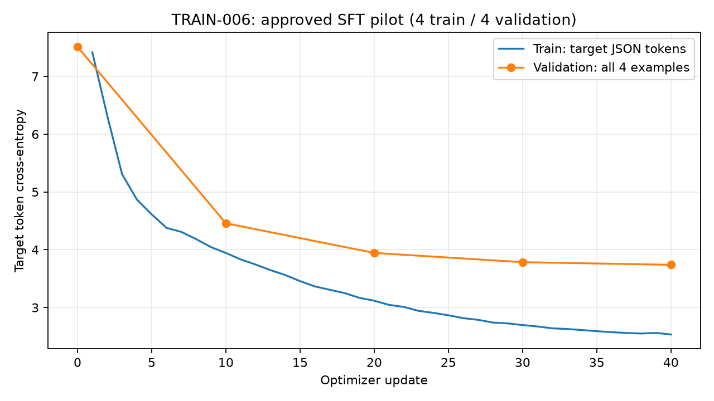

# SFT pilot reviewed: hasil 13 Oktober 2026

**Gerbang aplikasi: needs-more-data-and-model-work.** Pipeline approval, preparation, smoke, SFT dan evaluasi berjalan. Model belum menghasilkan PageSpec JSON valid.

## Mapping pekerjaan

| Tahap | Status dan bukti |
| --- | --- |
| Environment, download, pretraining | Selesai: baseline proyek bobot acak 1.200 update; tidak memakai bobot pretrained eksternal |
| Approval pilot v2 | Selesai: pengguna menyetujui 12 kandidat melalui chat; [provenance approval](data/ANNOTATION_APPROVAL_PILOT_V2.json) |
| Preparation reviewed SFT | Selesai: 12 accepted / 0 rejected / 0 duplicate, 12 family, 4 train / 4 validation / 4 test |
| SFT smoke | Selesai: TRAIN-005, 3 update; [report](training/TRAIN-005.json) |
| SFT pilot | Selesai: TRAIN-006, 40 update; [report](training/TRAIN-006.json) |
| Test pilot | Selesai: [metrik loss dan generasi](training/TRAIN-006_sft_evaluation.json); JSON/schema valid **0/4** |
| Notebook dan log | Lima notebook / 38 sel kode dieksekusi tanpa cell error; [notebook 05](../notebooks/05_sft_pilot_dan_evaluasi.ipynb), [log training](../logs/LOG_TRAINING.md) |
| Corpus instruksi memadai | Belum: hanya empat train, coverage terbatas; 14 kandidat tambahan masih perlu anotasi/review |
| Model menghasilkan website | Belum: generasi gagal parsing, tidak dirender |
| Browser/visual/interaksi | Belum dievaluasi; approval target JSON bukan browser acceptance |
| Aplikasi preview/unduhan | Tahap akhir, belum dibuat |
| Identitas empat anggota dan penerimaan domain oleh dosen | Belum dikonfirmasi kelompok |

## Hasil aktual

| Metrik | Smoke TRAIN-005 | Pilot TRAIN-006 |
| --- | ---: | ---: |
| Update optimizer | 3 | 40 |
| Initial validation target loss | 7,511530 | 7,511530 |
| Final validation target loss | 5,349698 | 3,739242 |
| Final train target loss | 5,380970 | 2,533280 |
| Target train tokens, termasuk pengulangan | 2.034 | 56.040 |
| Waktu trainer, termasuk validation/checkpoint | 8,655 detik | 11,717 detik |
| Peak allocated GPU | 1,122 GiB | 1,179 GiB |
| Peak reserved GPU | 1,234 GiB | 1,297 GiB |

Pilot test target loss **3,488259**, perplexity **32,728925**, 1.531 target labels / 2 batch / 4 contoh. Generasi **0/4 parseable**, **0/4 schema valid**, seluruhnya token_limit 768 tanpa EOS. Raw dimulai dengan pengulangan token seperti `_in_in`, kemudian tanda kutip/koma/titik dua; parse error pada karakter pertama. Raw tidak diperbaiki dan target benar tidak diklaim sebagai output model.

## Konfigurasi, lineage dan pemilihan

- Parent smoke dan pilot sama: `checkpoints/TRAIN-004-VERIFIED/best.pt`, phase pretrain, step 1.200. Pilot tidak memakai checkpoint smoke. Model proyek 14.186.496 parameter, 6 layer / 6 head / embedding 384 / context 1.024 / vocab 8.192.
- VENV aktual CPython 3.11.9, PyTorch 2.14.1+cu130, CUDA 13.0, RTX 5070, BF16. Pengukuran ini berasal dari eksekusi, bukan versi latest yang dicari ulang.
- [Config pilot](../configs/training_sft_pilot.json): AdamW, seed 42, batch 2 x accumulation 2, LR 1e-4 ke 1e-5, warmup 4, clipping 1, dropout 0,1. Validation seluruh empat contoh setiap 10 update; best step 40 berdasarkan validation.
- Budget/schedule ditetapkan sebelum test. [Config decoding](../configs/evaluation_sft_pilot.json): greedy temperature 0, max_new_tokens 768, seed 42. Tidak ada tuning atau pemilihan checkpoint dari test.
- BPE train-only, assignment family, corpus/token cache pretraining dipertahankan; SFT inherit partition sumber, tidak reshuffle atau memindahkan contoh test.
- Prompt/padding labels -100, target JSON + EOS labels aktif; label next-token sudah digeser. Target oversize ditolak utuh. Token loss menggunakan teacher forcing; generasi autoregresif memakai hasil model sebelumnya.
- Approval `user_chat_approval` mencatat persetujuan paket dari chat. Nama pribadi dan checklist per kolom tidak diberikan, sehingga tidak direka. Draft/worksheet asli tetap ada.
- Free disk setelah pilot 25.839.218.688 bytes, sekitar 24,07 GiB, di atas reserve 15 GiB. Checkpoint/data/raw output tetap lokal dan di-ignore, laporan/config/grafik/notebook/log dilacak Git.

SHA payload best pilot: `74705520f6f6c543dc8d9908057769fdf81f478159efb44b6e3966ca847c5540`.
SHA parent: `49e03ebb37f01619de9dc93a55f6828367d84fd34380986bfa15597d9583831c`.
Fingerprint pretraining: `fd6e3b5a20b3214cfd9e6cc769f7c011d3209235731edb793b917e60ca8a371a`.
Fingerprint SFT: `c53aca6888d29c73d3cca5ef01a0a6e556720d3c75dac0a60be454d1b65ef5f7`.

## Batas dan rencana berikutnya

Empat train examples diulang 40 kali, sekitar 160 presentasi. Ini menguji proses penyelarasan, belum generalisasi. Train berisi navbar, hero, text_section dan contact_form; feature_grid/footer/testimonial/pricing_table belum terwakili. [Profil aktual](training/SFT_PILOT_PROFILE_2026-10-13.json) memisahkan coverage setiap partition.

Perluas data train berdasarkan katalog section/interaksi yang telah ditetapkan, dengan provenance dan review manusia. Pertahankan assignment keluarga. Jangan melatih pada target pilot test atau menyesuaikan decoding/checkpoint dari test. Karena test pilot sudah dibaca, evaluasi ulang pada set yang sama bersifat eksploratif; penilaian generalisasi final memerlukan data yang belum dipakai untuk pengembangan. Ukuran corpus dan budget eksperimen berikutnya belum diputuskan.

Baseline code-token test loss 1,071/PPL 2,918 dan probe exploratory 0/4 memakai korpus/prompt berbeda. Jangan membandingkan loss atau menyebut perubahan kemampuan terhadap baseline dari dua evaluator ini. Mode evaluator `production` adalah gate ancestry/membership reviewed, tidak berarti aplikasi siap.

RUN-093 sampai RUN-099 menyimpan approval, preparation, smoke, pilot, evaluasi, authoring dan eksekusi notebook. Notebook 01 sampai 04 dipertahankan sebagai snapshot historis; source sama, output lama dipulihkan setelah rerun. Notebook 05 memuat status terbaru. Grafik diperiksa secara visual: judul, sumbu, legenda dan kurva terbaca. Tidak ada suite unit baru dijalankan pada sesi ini.
